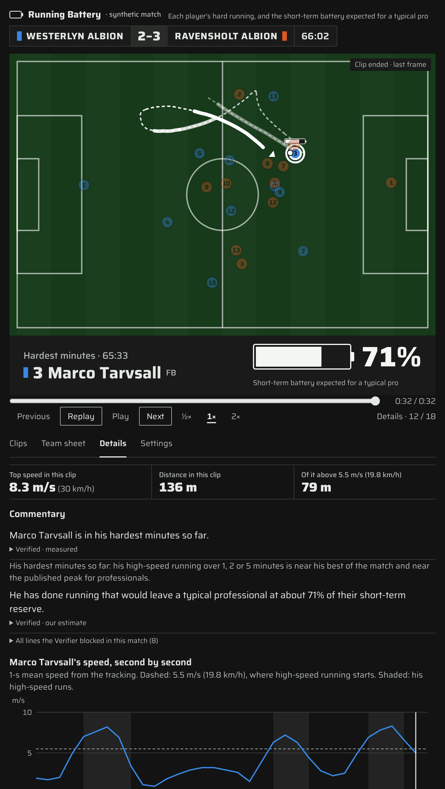
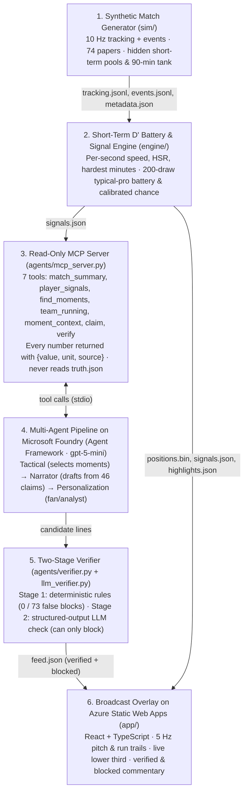
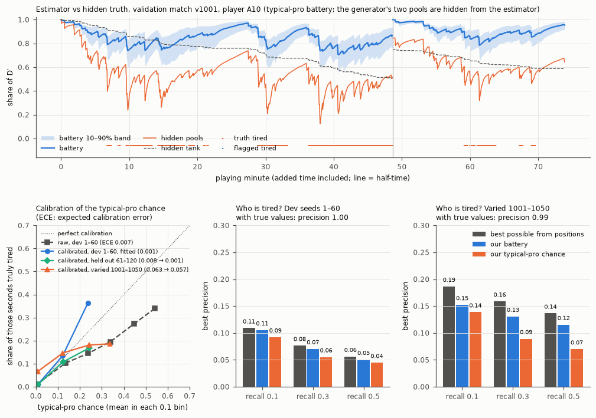
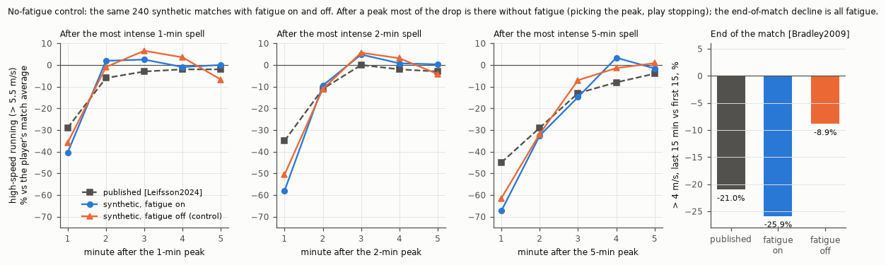

# Running Battery

> How much hard running each football player has done, and what it would leave a typical professional.

Running Battery measures from tracking data how much hard running each football player has done and what it would cost a typical professional, and explains it to fans and analysts through AI agents on Microsoft Foundry. It is an entry for the Microsoft x Premier League "Inside the Game" hackathon.

All match data is **synthetic**: we built a generator whose players get tired according to published sports science, with a hidden "true" fatigue we use to test our estimator.

**Try it:** https://happy-bay-06ca1e90f.3.azurestaticapps.net/?match=story (the story match, fan mode).
It opens on the **Highlights**: a card for each clip of the match, then the first clip, stopped until you press Play; each clip plays once as it happened, beside its details (the numbers and the commentary); "Replay" plays it again (a progress bar, Play/Pause and ½× 1× 2× work like a video player's), and "Full match" is the whole replay.
Add `?match=natural`, `&mode=analyst`, `&view=full&t=<seconds>`, `&hl=<kind>&step=details` (or `&step=replay` for the replay), `&tab=stats` (the teams' running, 15 minutes at a time), `&view=how` (How it works: the battery, the agents, the data and a live match) or `&theme=dark` to the address.



- Project plan: [docs/PLAN.md](docs/PLAN.md)
- Build plan: [docs/BUILD_PLAN.md](docs/BUILD_PLAN.md)
- Evidence base (74 papers): [docs/RESEARCH_SYNTHESIS.md](docs/RESEARCH_SYNTHESIS.md); citation keys such as [Leifsson2024] are in [docs/References.bib](docs/References.bib)
- Data format: [src/runningbattery/schema.py](src/runningbattery/schema.py), JSON Schemas in [schemas/](schemas/)

## How it works



1. **Generator** (`sim/`): a 10 Hz match with events, a sprint motion model [Narizuka2023], role behaviours and a hidden physiology (two short-term pools and a whole-match tank) that changes which hard runs players make.
2. **Estimator** (`engine/`): from positions alone, per player and second, the running (high-speed distance, his hardest minutes so far, energy) and what it would leave a typical professional (a battery with a 10–90% band, and a calibrated chance of falling below half of it). The battery drains above critical speed and refills below it, more slowly the more hard running there has been in the match (wear, decision 56).
3. **Agents** (`agents/`): an MCP server with seven read-only tools, four agents on Foundry, and a Verifier that checks every sentence against a register of published claims.
4. **Overlay** (`app/`): the replay, the batteries, the charts and the verified feed, as static files on Azure.
5. **Live runner** (`live.py`, decision 58): the estimator fed one tracking frame at a time, with a one-way speed filter and the engine's own battery step. On the story match its battery stays within 0.4 points of the replay's on average (95% of player-seconds within 1.4), speeds come 0.5 s later, each second of play takes 1.5 ms, and 128 of the replay's 134 stretches of hardest minutes are flagged live within 30 s (natural match: 0.3 points, 71 of 78). Fed the replay's speeds, it gives the replay's battery exactly (`tests/test_live.py`). Not connected to a provider's feed or a broadcaster's graphics.

## Agents

Four agents on Microsoft Foundry (Agent Framework, gpt-5-mini) turn a match into a timestamped,
verified feed (`feed.json`, synced to the replay or a video by `video_s`). They see the match
only through an MCP server with seven read-only tools, and every number comes back with its unit
and the field it came from; nothing in `agents/` can read the hidden truth. **Tactical** picks
the moments (a player's hardest minutes, a defender caught on the break, second wind, fresh legs, a quiet spell
that is likely tactical rather than fatigue, flat-out runs near a player's top speed, and who's doing
the running between the two teams, with where it happened); **Narrator** writes from the claims register's wordings;
**Personalization** sets the fan or analyst style (there is no favourite player: the feed
describes the match's most relevant moments, decision 42); **Verifier** checks every sentence before it reaches the screen.

Plain code holds the agents to what the prompts ask: each moment offers only the claims that fit
it (the "after a player's hardest 5 minutes" figure only after a stretch that long, "top speed hardly drops"
only after the 75th minute), a team moment always says how the two teams compare, each general
finding is shown at most twice per feed, and "fewer touches" needs measured touch counts
(PLAN decision 25). The best moment of each kind is always in the feed, whatever the Tactical
agent picked, and so is a turnover that cost a goal (decision 42). A substitute's moment always
compares him with his team-mates, and a caught-on-the-break moment says what his running would
leave a typical professional (decision 31). A line tagged with a general finding whose numbers all come from the moment's
facts counts as a measured fact (decision 29). A team moment also says where the team's
high-speed running happened, as measured facts per minute of each situation (decision 30, below);
claim 4 ("losing the ball forces the hardest running of the game") may go with it, but not its
"tired legs", which on a team moment would be about the team (claim 35).

### The Verifier

It runs fixed rules first, then an LLM pass that can only block, against the claims register
(synthesis §5) and the moment's context: a sentence that blames fatigue while the team is 3–0
up, the ball is out of play or the player has just come on must say so, and every number must be
one of the facts. The paraphrases are blocked claims in other words, and the fact checks are
sentences that do or do not agree with their facts (F1); both were written before the rules or
the prompt that could catch them and never used to tune them. On 192 test sentences
([docs/verifier_report.json](docs/verifier_report.json), prompt revision 7, run on 2026-10-21 after
decision 37's rule changes ("typical pro" as a rule-24 baseline, G12: a published finding opened
with a player's name, rule 33 reading "his (estimated) typical-pro reserve", and G5 asking a team's
metres per minute to say they are high-speed running) and decision 38's rules, each from a line on the site's feed: G13, a scoreline is the score at
that moment (claim 13's example "a 3–0 lead" at 5–2); G5 for players too ("He averaged 23
m/min."); "level" only for no difference (two teams 5% apart); G14, the player a substitute
replaced is not compared "over the same minutes"; G9, the short-term reserve as a percentage rather
than a raw decimal; and claim 2 keeping "shaken off" or "recover"; and decision 39's G5 for a
percentage of plain "running" ("96% less running" that was his high-speed running)):

| | Unsupported sentences caught | Valid sentences blocked |
|---|---|---|
| Rules alone | 87 / 119 (paraphrases 2 / 23, fact checks 0 / 6) | 0 / 73 |
| Rules + LLM | 116 / 119 (paraphrases 23 / 23, fact checks 4 / 6) | 1 / 73 |

Since decision 41 the rules also block "the lowest point of his match so far" unless the
unrounded battery is at its lowest (86 / 119 before; the LLM row is the run of 2026-10-21).

The LLM still misses sentences that mislead without a wrong number: claim 3 ("about a third fewer
recovery runs right after their hardest minutes") used as the lead-in to a defender's own speed
after a turnover, and two of the six held-out fact checks ("his fastest run so far" when it was
not, and "well below his match average" when it was not). The LLM pass varies: the ten runs on
2026-10-20–21, as the suite grew from 174 to 192
sentences, caught 106 / 108, 103 / 108, 106 / 109, 106 / 111, 110 / 112, 109 / 113, 113 / 115,
112 / 116, 114 / 118 and 116 / 119 and blocked 2 / 66, 1 / 66, 3 / 67, 4 / 68, 0 / 68, 3 / 69,
5 / 71, 4 / 72, 4 / 72 and 1 / 73
valid sentences (the 182-sentence run missed three of the six fact checks; the 188-sentence run missed one
paraphrase, "They swarmed the man on the ball to win it back high up the pitch"); the earlier runs also missed "the lowest
point of his match" when it was not, a team comparison with the wrong percentage ("roughly 22%
less") and a second fact check. With prompt revision 5 (166 sentences, 97/104) it also missed "the lowest point of his
match" when it was not and three of the six held-out fact checks, so the LLM pass is a second net,
not a guarantee. A general finding about short bursts used to explain a 76- or 197-second spell,
which it missed in every run, is now blocked by a rule (claim 2, below). In this run it blocked
four valid sentences: "He ran less after the break than before it" (claim 15), the typical-pro
chance worded with "in the red", "Fewer touches, partly because the ball was out of play more" and
"He did 64% more high-speed running per minute than his team-mates over the same minutes and 1% more than the player he replaced". Earlier runs
also blocked "Without the ball, Ravensholt are covering more ground per minute than with it", "His team kept the ball for most of the last five minutes, so he ran less; likely not
fatigue", "86% below his match average", a drop in running put down to a long stoppage and a
team's share of its high-speed running in the 10 s after the ball changed hands. The rules never block a valid sentence; the LLM pass varies by a sentence
or two from run to run (the first run of revision 6, on 173 sentences: 106/108, 1/65, with one
LLM check timed out).

The LLM prompt has been revised six times, each reported in PLAN §3.4: twice on the first
suite; once after the fourth demo feeds, where it blocked the neutral name of the post-peak window
as physiology seven times; once (decision 29) for the new names and a fact check it writes
before each verdict; once (decision 30) for "his hardest minutes"; and once (decision 31) to read
the moments' names ("second wind", "fresh legs", "caught on the break", "quiet spell") as
football's names for kinds of moment, after it once read "Second wind" as physiology. Rules added from reading
the feeds: no field names on screen ("G10"), "not only fatigue" as a statement about the
player's own state (claim 33), and baselines in words ("of the last five minutes"). With the
running split (decision 30): "pressing" and "closing down" are blocked (claim 39, below), on a
team moment any fatigue word is read as the team's own state (claim 35), and a share of the
running in a situation must give the share of the time too (G5). From reading those feeds:
"his typical-pro battery" (claim 33), "spell" for his hardest minutes, a reason pinned to the
typical-pro wording ("the two-goal lead may explain some of it"), percentages spelled out
("forty-three percent", which the numbers check cannot read) and claim 4 pinned on a player
("…one of those moments for Marco Tarvsall", while he ran at about 1 m/s). From the site's feed
(decision 31): "0% more" for two sides that were level (G10), a word both team names share
standing for one team ("Albion's", when both teams are "… Albion"; G11, a new global rule), and
claim 2 ("short bursts are shaken off in a minute or two") in a sentence that gives his own
stretch's length in seconds or minutes. Its held-out cases were written before the rule: the rules
caught 0 of 2 before it and 2 of 2 after, with both valid ones passing.

## The overlay

`app/` is a match broadcast, cleaned up (decision 36; the screens in [JOURNEY.md](JOURNEY.md),
the look in [DESIGN.md](DESIGN.md)). Since decision 49 an overview comes first: a top bar (the
brand line "Running Battery · synthetic match" with what it shows; the view, the match, fan or
analyst), then **1 Pick a moment**, one card per clip in match order (its time, what it is, the
player, and the battery a typical professional would have at its end), then **2 Watch it**, the
score bug with each team's colour, the pitch, one lower third docked under it and a quiet play bar,
beside **3 What it shows**: the tabs **Details**, **Team sheet** and **Settings** (dark or light,
the key; the full match adds **Clips**), and under them **4 The whole match**: both teams'
high-speed running in each 15-minute block beside the two team charts (decision 50). One line
under each step says how to read it. On a phone
the columns stack. While a clip plays, only the score, the pitch and the lower third ask for
attention.

It opens on the **Highlights** (decision 29): one clip at a time, in match order, from the
match's best physical moments and the feed's moments. The page opens on a clip stopped (the
first recovery run, decision 50), with "Play the clip" on the pitch (decision 49: a clip that played at once left no time to see what
the page is); a card, Play or Next starts a clip without moving the page (decisions 51 and 57),
and a link that names a clip opens with the pitch in view. During a clip, clicking any other player shows his battery
and its percentage on the pitch. A third view, **How it works** (decision 52), explains the battery
(with the opening clip's run and its drain and refill), the agents and the check, the data it needs
and the live runner, and cites its research with numbered references (decision 60).
Each clip plays once, as it happened, at
normal speed, with only that player's path on the pitch (the others dimmed), in white, fading
towards its start with an arrowhead where he is. A moment measured over minutes shows the part
of the match it is about (decision 38): a counter-attack after his team lost the ball, or the run
behind a second wind or a substitute's fresh legs, on to the end of that play; a moment with
nothing to see stays in the full match's commentary, and one action is one clip. Some clips were
removed by hand because their movement did not look like football (decision 48: every
caught-on-the-break and quiet-spell clip, and two more in the story match), and every second-wind
clip because those moments matter less (decision 57); their lines stay in the full match's
commentary. A clip whose play
ends in a shot runs on to the shot and the ball's arrival (decision 46: three clips had stopped
3–14 s before it). A clip stays inside its half, and a highlight
that spans a minute (back-to-back runs, the busiest minute) fast-forwards at 4× between the
player's high-speed runs, with "Fast-forward to his next run" on the play bar (decision 39).
Real tracking loses players for a moment (we
simulate it too, so the estimator copes with gaps); the pitch draws such a player faded, on the
line between where the tracking last and next saw him.
When it is over it stops on its last frame ("Clip ended · last frame"). The **Details** tab beside
it (decision 34) has the numbers (top speed, distance, metres above 5.5 m/s, the gap timer between
back-to-back runs), what the feed says about it, the run's speed second by second (not for the most
ground covered: decision 49 dropped its distance-since-kick-off chart; decision 50 dropped the
comparison with a published number); analysts get the 10–90% band as the first line. The Verifier's verdicts and blocked
lines are not on the page (decision 49: too much for a match page); they are in the feed files,
[docs/feeds/](docs/feeds/), and in the Verifier section below.
**Replay** plays the clip again at the clip speed (1× unless the viewer picks ½× or 2×), with the numbers growing; the progress bar seeks within the clip; **Next** starts the next
clip and gives back the tab the viewer was on. "Play highlights" leaves the details up for 6 s
before the next clip. The full match's Clips tab shows each team's fastest second so
far.

**The battery is the one bold graphic** (decisions 32, 33, 36). The lower third names the clip or
moment and its player and shows his battery as the clip plays: what his running so far would leave
a typical professional, a squared shell with a near-white charge that never changes colour with its
level, the percentage beside it, and for analysts the 10–90% band as brackets. The Team sheet tab
lists both line-ups
with each player's battery, live; a click follows that player in the full match. Goalkeepers get
none. The empty shell is the logo.

**Full match** is the whole replay. In fan mode it shows a battery icon for the selected
player (a tick shows all of them); in analyst mode the selected player's battery trace
with its band and his high-speed running. To keep one obvious place to look, the player the
current feed line is about gets a ring and the lower third; the flat-out pulse
(90% or more of his top speed so far) and the hardest-minutes ring show only for him and the selected
player, and the key is in Settings.

**Stats** (decision 46) holds the teams' running over the whole match, as statistics rather than
clips: a team comparison covers fifteen minutes, and its clip showed a few seconds of them (once a
dead ball). Each 15-minute block gives both teams' high-speed running per ball-in-play minute, the
feed's team lines about it and a link to the full match there. Then both teams' high-speed running per
ball-in-play minute as one chart, "High-speed running per minute", and under it **high-speed running
by situation** (decision 30) splits each team's high-speed running by situation of play, from who
had the ball and where it was, as metres per minute of that situation (G5): the first 10 s after
losing the ball, the first 10 s after winning it (transitions last 9.3–10.9 s on average
[Bortnik2022, Table 2]), settled on the ball, and without the ball with it in the opponents'
third or deeper (the pitch in thirds, 17.5 m either side of halfway). Bars per team on one scale,
the minutes of each situation under its name, and per team the share of its high-speed running
that came in the 10 s after the ball changed hands; it sums the finished 15-minute blocks so far,
and a team moment's Replay shows its own block. Over the story match, 56% of Westerlyn Albion's
high-speed running came in those 10 s, in 50% of the time the ball was in play (257 m per minute after losing the ball against 161 settled on the ball). It says where the
running happened, never why: "pressing" is a purpose, and positions don't show it (below). All of the
overlay's own text, labels and tooltips included (`app/src/copy.json`), passes the Verifier too.
Dark by default, light in Settings; phone layout with a 16 px gutter, plain dots on the pitch and
no sideways scroll.

**Highlights** are measured from positions and named as football names them: **top speed**
(against the average match top speed for his position [SilvaH2025, Table 1]), the **longest
run** above 5.5 m/s (19.8 km/h) in one go and where it went (a typical high-speed run is about
19 m [Fang2024, Table 2; DiSalvo2007, p.224]), the **recovery run** (the longest high-speed run
back towards his own goal starting within 10 s of his team losing the ball, our threshold; speed
and distance only; against the generator's hidden run purposes it is a recovery run 50% of the
time, base rate 18%, and finds 27% of them, dev seeds 1–60, decision 47; most of the rest are
covering runs and the counter-press's close-down runs), **back-to-back runs** (three or more with 20 s or less between them, our
threshold; Premier League players usually get 51–101 s between high-speed runs, by position
[Bradley2009, Table I]), the **busiest minute** (against a published average best minute of
62 m [Leifsson2024, Table 1]) and, at the final whistle, the **most ground covered** by
whole-match players (against the Premier League average for defenders, midfielders or forwards,
9.97 / 11.59 / 10.71 km [Kavanagh2024, Table 2]; Bradley2009, Table I agrees by position within
1–8%). The story match is short (92.8 min with added time, against a usual 99.5 [Allen2025,
Table 2]), and its most ground covered is 10.7 km. The panel shows the top 3 so far, one per
player; a click opens the clip (a clip removed by hand keeps its number, with no link), and "Play
highlights" plays the clips one after another.
Captions come from fixed templates and pass the Verifier; they describe what the player did,
never how hard he tried (claim 38). Hardest accelerations and stops are left out: tracking
systems count them about 10-fold apart (claim 32).

The demo feeds are in [docs/feeds/](docs/feeds/): the story match (seed 2028, a high press that
fades, a full-back caught on the break again and again, a fresh substitute; the one the site
and the video use), and a natural match (seed 2031). Story
matches are never used for validation numbers.

## What we tested and don't claim

Each of these is a sentence fans would like to read. We tested it against the hidden truth of
synthetic matches, it does not hold up from positions, and the Verifier blocks it:

- **"He is tired."** With each player's true fitness, the generator's own physiology finds the
  tired moments almost perfectly (precision 0.997); without it, the best any positions-only
  detector reaches is precision 0.20 at recall 0.1, and our battery reaches 0.15 (dev seeds 1–60,
  [validate/ceiling.py](src/runningbattery/validate/ceiling.py)). The same running drains players of
  different fitness very differently. So we say what the running would cost a *typical*
  professional (claims 11 and 33).
- **"Which team is more tired."** Home-minus-away differences pick the team with more
  short-term tiredness 42–57% of the time (chance 50%; with 60 matches one match is 1.7 points).
  They pick the team with more late-match wear 32–70% of the time (the typical-pro chance does
  best, 70%), plain high-speed running nearly as well (62%), and more than one match in four is still wrong (60 matches,
  [validate/teams.py](src/runningbattery/validate/teams.py)). We show the measured running
  instead: team totals per ball-in-play minute, and how a gap changed (claim 35).
- **"He ran slower than he could when it mattered."** After his team lost the ball, a slow defender had no
  run asked by his role in 94% of cases and skipped one in 4.4%; speed does not tell a skipped run
  from no run asked (AUC 0.37: below chance, so slow windows were if anything less often skipped
  runs). We give the speed, its share of his top speed and
  what happened (claim 38).
- **"He misplaced that pass because he was tired."** Pass completion is the same before and
  after a peak spell (80.3 vs 80.5% [Fang2024, Fig. 1]) and across the match [Carling2011,
  Table I], so the generator has no passing penalty and the Verifier blocks the claim (claim 20).
- **"Albion pressed high."** Pressing is what a run meant to do. A positions-only rule built on
  Ju2022's definition of closing down ("runs directly towards opposition player on or receiving
  the ball" [Ju2022, Table 1]: his team without the ball, the gap to the ball shrinking by 3 m or
  more and ending within 5 m) matches the generator's hidden close-down runs with precision 0.56
  (base rate 0.18) and recall 0.14; in the opponents' third, 0.62 and 0.01 (73,863 runs, dev seeds
  1–60, thresholds fixed before the first run, [validate/purposes.py](src/runningbattery/validate/purposes.py)).
  The split above shows where the running happened instead, and the Verifier blocks "pressing" and
  "closing down" (claim 39). A recovery-run rule does no better (precision 0.55 against a base rate
  of 0.18, recall 0.39 with Ju2022's "to be goal side when out of position"; 0.70, 0.21 and 0.41
  before decision 47): a recovery-run share would come out about 80% of the true one, with 45% of
  it other runs (mostly the counter-press's close-down runs), so the split leaves it out. Since
  decisions 46 and 47 (the counter-press, a second presser in the build-up) 44% of the close-down
  runs the pressing rule finds are still other runs, so pressing stays out.
- **"They won because they ran more."** Winners outrun losers only slightly (total distance
  +0.7% [Allen2026a, Table 3]) and total distance is unrelated to points [Allen2026b] (claim 30).

## Validation

**Estimator vs hidden truth.** The battery (blue, with its band) against the generator's hidden
pools (orange) for one player of a validation match; the calibration of the typical-pro chance
before and after its map (held-out matches: expected calibration error 0.022 → 0.001); and how
well anything could tell *who* is tired from positions alone (above).



**Wear (decision 56).** The battery's refill slows as metres above critical speed build up over
the match: refill time × (1 + α (1 − e^(−W/scale))), W the metres above CS so far, half of them
cleared at half-time; α 1.0 and scale 400 m were fitted on dev seeds 1–60 (a grid of 12, the
lowest error within 0.001 with the bias nearest zero). Against the hidden pools, before → after:

| | Dev 1–60 (fitted) | Held out 61–120 | Validation v1001–1050 (varied players) |
|---|---|---|---|
| Mean absolute error | 0.063 → 0.058 | 0.063 → 0.059 | 0.098 → 0.093 |
| Bias | +0.036 → −0.002 | +0.032 → −0.007 | +0.063 → +0.025 |
| 10–90% band coverage | 67% → 79% | 68% → 78% | 50% → 60% |

It finds the truly low moments no better (best precision at recall 0.1: 0.16 → 0.15; positions
cannot tell who is less fit). The generator has a similar mechanism (its whole-match tank slows
its slow pool [Chorley2022]), so part of the gain is the test bench agreeing with itself. On the 7
real IDSSE matches the battery dips deeper: the median lowest battery per player 0.70 → 0.66, and
5% of players go below half (none before), against 0.79 ± 0.06 published for university players
[Sutcliffe2025, Fig. 3]. No version of the battery, with or without wear, tells which real players
fade in the last 15 minutes (Spearman 0.03 → 0.04).

**No-fatigue control.** The same 240 synthetic matches with fatigue switched on and off. Most of
the published drop after a player's most intense spell appears even without fatigue (picking the
peak guarantees a lower value next, and play stops after peaks [Cortez2026, Table 3]); the
end-of-match decline is all fatigue.



**Realism.** 240 default synthetic matches (seeds 1–240) with fatigue on, and the same matches
with fatigue off in brackets, against published numbers. Our pass bands are proposals (synthesis
§6.1). Every row was re-run on the same 240 seeds on 2026-10-27, the freeze before submission
(PLAN decision 47; decision 46's rows are in the README at commit 64f9b6c, decision 45's at
1f69432, decision 40's at 9120300), after six changes to the generator. Decision 41: defenders follow the runner they track and no longer sprint
straight back, duels need the players within 1.5 m, a low pass that reaches an opponent is cut
out, and substitutes come on at the halfway line. Decision 42: the generator's knobs are fitted
by an algorithm instead of by hand (`sim.calibrate`: the method of simulated moments, Sobol
designs, a least-squares response surface and trust-region Levenberg–Marquardt steps, on seeds
never used for these tables). Decision 43: players brake late, a recovery run's speed grows with
how far out of place he is, forwards drop back at running pace, and the fit also targets the
shape of IDSSE's running (short runs, runs close together, turn-backs; "Checked on real matches"
below). Decision 45: an overlap goes outside the winger with a lane along the touchline and
inside him without one (it had aimed at his own spot), a run about the ball carrier ends when he
passes, a run's target keeps 4 m from team-mates', and the knobs were fitted again. Decision 46:
runs in behind hold the offside line until the pass and runs re-decide when it goes elsewhere,
the cover defender runs at the pace his gap asks, the team that lost the ball counter-presses,
runners keep out of team-mates' spots and lanes, keepers claim high balls into their six-yard box
and come out to a carrier through on goal, long stoppages need a cause, and the knobs were fitted
again with goals and close-range shots from Wyscout's Premier League as targets. Decision 47:
while the keeper has the ball, opponents keep out of his penalty area and 10 m from him (forwards
had held shape spots inside his six-yard box) and nobody presses him; out of possession only the
back line stepping up together sprints upfield into shape (midfielders and forwards had sprinted
away from their own goal while the other keeper held the ball); a midfielder already well ahead of
the ball makes no backward support run; defenders do not counter-press in the opponents' half; in
the build-up a second presser (a forward or a central or holding midfielder) goes at the carrier,
3 m from the first, aiming where a moving carrier will be, and the cover no longer takes over a
presser's job; an overlap goes on when the pass goes forward; and the knobs were fitted again.
Then two fixes at restarts: a defender inside the 9.15 m circle steps out towards his spot round
its edge (stepping straight out, a wall member who had come in fast stood 2 m off his spot for
the whole wait), onto the pitch by a touchline (pushed out over the line and clipped back, a
player stood 7 m from a free kick); the knobs were kept. Against decision 46: shots 28.9 → 23.1
a match (within ±15% again) and goals 3.6 → 3.2, high-speed running with the ball +18.9 →
+10.8% and without it −11.8 → −5.7%, the share of high-speed running without the ball done
within 10 m of it 26 → 43.8% (real 44.5–54%, "Checked on real matches" below), team sprint
distance −5.5 → −2.2%, covering and recovery runs after a peak both in Ju2022's range; holding
midfielders' high-speed running −14.7 → −12.8% and central midfielders' −8.3 → −3.5%; worse:
wide and attacking midfielders' high-speed running (−2.9 → −8.7%, −2.4 → −5.8%), central
midfielders' sprint distance (−11.6 → +17.3%), keepers' high-speed running (33 → 42 m, +26%) and
corners (6.9 → 5.7 a match). The second half's high-speed running is 13.3% below the first
(14.4% at decision 46). The user accepted the gaps for the movement it fixes (PLAN decision 47).
**Accepted gaps** (as decision 11): high-speed running of holding, wide and attacking midfielders,
sprint distance of centre-backs and central midfielders (and attacking and wide midfielders', 9–10%
short), high-speed running with the ball, the second half's drop (between the published "about
level" and IDSSE's −21%), keepers' distance and high-speed running, the first minute after a
peak, substitutes, goals and corners a match, and the home–away correlation of total distance.

| Check | Published (source) | Synthetic (no fatigue) | |
|---|---|---|---|
| Running > 4 m/s (14.4 km/h), last 15 min vs first 15 | −21% [Bradley2009, Fig. 2]; pass −10 to −30% | −27.2% (−8.6%) | pass |
| High-speed and sprint running, 2nd half vs 1st | about level [Bradley2009, p.162]; pass ±10% | −13.3 / −12.4% (−6.6 / −6.5%) | below (accepted gap; IDSSE's real matches −21%) |
| Recovery time between hard efforts, last 15 min vs first 15 | +28% [Bradley2009, p.162–163]; pass +15 to +40% | +27.6% (+6.4%) | pass |
| 2nd half vs 1st, by first-half load (high / moderate / low) | −12 / 0 / 0% [Bradley2013, p.4] | −18 / −12 / −7% (−11 / −4 / −1%) | deeper than published |
| Substitutes vs whole-match players, same minutes | +15% [Bradley2013, Table IV] | +28% (+12%) | above (accepted gap) |
| High-speed running after a 5-min peak, min 1–5, vs match average | −45 −29 −13 −8 −4% [Leifsson2024, Table 1] | −68 −35 −13 −7 −2% (−61 −27 −17 −2 +2%) | minute 1 too deep, even without fatigue (accepted gap) |
| 1-min high-speed peak | 62 m/min [Leifsson2024, Table 1] | 66 m/min (69) | close |
| Covering and recovery runs in the 5 min after a peak, vs match average | −22 to −44% and −34 to −43% [Ju2022, p.975] | −35 / −35% (−27 / −26%) | both in range; without fatigue recovery runs short of it |
| Hard runs after a peak: length, duration, speed | −23%, −32%, −3% [Fang2024, Table 2] | −21%, −19%, −3% (−20%, −18%, −2%) | shorter but not enough |
| Distance, high-speed and sprint per position | 2024/25 targets ±5% [Allen2024, Table 4; Allen2025] | distance within ±5% (keepers +8.6%); high-speed running CF +2.3, FB −2.7, CM −3.5, CB −3.6, AM −5.8, WM −8.7, DM −12.8%; sprint distance DM −0.1, FB −2.9, CF −3.4, AM −9.3, WM −9.6, CB −14.6, CM +17.3%; team sprint −2.2%, high-intensity −4.3% (keepers' high-speed running 42 m, +26%) | accepted gap |
| Shots and goals per match | 24.4 shots [Bassek2025, p.6]; Wyscout's Premier League 23.4 shots and 2.6 goals [Pappalardo2019]; shots pass ±15% (PLAN §2.5) | 23.1 shots; 3.2 goals | shots pass; goals above (accepted gap); shots from inside 6 m 7.4% (dev seeds 1–60; Premier League 3.7%, ours 14% before decision 46 and 7% at decision 46) |
| Time in speed bands vs real tracking (IDSSE) | ±3 points [Bassek2025; Osgnach2010] | outfield within 1.9 points | pass |
| Ball in play | 50–63% [Kavanagh2024, p.80; Allen2026b, Table 2] | 59.0% | pass |
| Running by phase, per player slot | 133 / 145 / 63 m/min with the ball / without / stopped [Allen2026b, Table 5] | 129 / 141 / 59 (−2.7 / −2.7 / −6.4%) | pass (±10%) |
| Home and away teams move together | r = 0.68–0.75 [Allen2026a, Fig. 2]; pass 0.5–0.85 | high-speed 0.79, high-intensity 0.80, sprint 0.67; total distance 0.96 | total distance above (accepted gap, decision 11) |
| Energy per player and match | 61.1 ± 6.6 kJ/kg [Osgnach2010, p.174] | 59.3 ± 4.9 kJ/kg (dev seeds 1–60); real IDSSE 57.6 ± 4.5 | close |

**Same conclusions on real data.** We ran the estimator offline on the 7 real IDSSE matches
[Bassek2025] (calibration only; the data never enters the repo or the demo) and compared
conclusions, not accuracy (there is no fatigue truth there; PLAN §2.6). They agree on load,
distance per player, the battery's dips, the deep first minute after a 5-min peak and, since
decision 43, the peaks themselves (1-min peak 65 vs 65 m/min, 5-min 24 vs 23; it was 71 vs 65
before decision 43). They disagree in one place, less since decision 46: real players faded more
in the second half (high-speed running −21% vs our −14%; −13% at decision 46, −4% before it).

**Checked on real matches.** Every real match we could get, and not one source: since decision 46
each check runs, through the same code, on the 7 IDSSE matches [Bassek2025] (Bundesliga, TRACAB),
the 20 SkillCorner Open Data matches (A-League 2024/25, broadcast tracking with players off camera
extrapolated, MIT), Metrica Sports' 2 sample matches, Wyscout's 380 Premier League 2017/18 matches
(events only [Pappalardo2019]) and 30 natural synthetic matches (seeds 1–30). Each real match is
written as one of our match folders (`validate.real_events` for IDSSE, scratch converters for the
others); the range real football covers is the 10th–90th percentile of the real matches' values,
each match counted once, and a synthetic mean outside it is marked. The converted real matches
stay on our machine: no real data, raw or derived, is in this repository or on the site.
Metrica's events miss stoppages, so it does not count for ball in play or long stoppages, and its
possession for the offside and near-the-ball rows. Per 90 player-minutes of outfield players,
unless marked:

| | IDSSE (7) | SkillCorner (20) | Metrica (2) | Real range | Synthetic (30) | Before decision 47 |
|---|---|---|---|---|---|---|
| High-speed runs (above 5.5 m/s) | 49.7 | 59.4 | 39.1 | 43–71 | 55.9 | 57.9 |
| Runs lasting 1–2 s | 61% | 61% | 59% | 58–63% | **71%** | **69%** |
| Runs of 5 s or more | 5.8 | 7.2 | 5.8 | | **2.5** | **2.7** |
| Runs starting within 20 s of the last | 9.2 | 10.6 | 6.4 | 6.8–14.5 | 12.9 | 13.0 |
| Turn-backs (a run within 10 s heading the other way) | 2.1 | 2.4 | 1.4 | 1.4–3.2 | 2.3 | 2.2 |
| Runs of 15 m or more ending within 2.5 m of a team-mate, per in-play player-hour | 1.14 | 1.24 | 0.74 | 0.8–1.8 | 1.41 | 1.15 |
| Seconds more than 5 m offside, per attacking in-play player-hour | 6.1 | 3.5 | | 1.8–9.5 | 2.0 | 2.6 |
| High-speed runs ending over 3 m offside | 0.2% | 0.2% | | 0–0.8% | 0.5% | 0.3% |
| High-speed metres with the ball within 5 m of the offside line, per 90 in-play min | 110 | 96 | | 68–125 | 113 | **131** |
| Share of high-speed running without the ball done within 10 m of it | 51% | 47% | | 44.5–54% | **43.8%** | **26%** |
| Ball in play | 55% | 54% | | 49–60% | 59% | 58% |
| Stoppages over 60 s per match (each with a goal, a substitution or a booking since decision 46) | 6.3 | 8.0 | | 3–11 | 5.6 | 5.6 |
| Gap between the teams per 15-min block: median; 90th percentile | 9.6%; 22% | 14.5%; 31% | 7.1%; 24% | 7–24%; 17–42% | 11.6%; 27% | 11.7%; 27% |
| Hardest-minutes moments | 2.78 | | | | 2.85 | 3.08 |
| Second winds | 2.07 | | | | 2.12 | 2.18 |
| Quiet spells (a drop that may not be fatigue) | 1.20 | | | | 1.14 | 1.14 |
| Caught on the break; highest count in a match | 0.95; 7 | | | | 0.77; 10 | 0.80; 7 |
| Fresh legs | 0.34 | | | | 0.23 | 0.25 |
| Flat-out moments | 3.95 | | | | 4.99 | 5.27 |
| Team-gap moments per match | 1.86 | | | | 2.80 | 2.80 |
| Back-to-back bouts | 1.18 | | | | 2.28 | 2.20 |
| Recovery-run highlights | 4.07 | | | | 5.69 | 5.62 |

Events per match against Wyscout's Premier League 2017/18 (mean, 10th–90th percentile of its
matches) [Pappalardo2019]: shots 23.4 (17–30), ours 22.9 (30.2 at decision 46); goals 2.6 (1–5),
ours 2.9; corners 10.3 (6–15), ours **5.3** (7.4 at decision 46); offsides 4.1 (1–7), ours 3.3;
fouls 21.4 (15–28), ours 24.4; throw-ins 44.9 (33–58), ours 34.7; duels 233 (189–276), ours 191
(187); passes 865 (715–1019), ours **711** (684; open play). Shots from inside 6 m of goal: 3.7% of
Wyscout's, ours 14% before decision 46 (keepers never claimed a ball into their six-yard box),
7.1% at decision 46 and 6.5% now.

Pooling the sources changed two conclusions: the gap between the teams per 15-min block, wider
than IDSSE's, is inside the real range once SkillCorner's matches count; and the short, bunched runs
are confirmed by every source. The missing pressing near the ball, which every source confirmed at
decision 46 (26% of high-speed running without the ball within 10 m of it, against 44.5–54%), is
nearly closed by decision 47's build-up press (43.8%). Every real moment we watched
as a clip read as its line. The volume of running is set by the Premier League targets above, and
these are lower-volume leagues, so the run counts are higher by design; the shape (short runs, runs
close together, turn-backs) is fitted as shares. What is still synthetic is in the limitations.

## Synthetic-data card

One paragraph per dimension of the checklist in [RuizPinto2026, Table 3].

**Objective.** The data exists to test an estimator of how much hard running players have done
and what it would cost a typical professional, against a fatigue state that real matches never
reveal. It is not meant to stand in for real matches in any other analysis.

**Structure.** Four files per match: 10 Hz tracking of 22 players and the ball (positions in
metres, ball in or out of play, possession), events (passes, carries, receptions, shots with xG,
duels, pressures, substitutions and more, each with a phase of play), metadata (line-ups,
positions, substitutions) and, for validation only, the hidden truth (two short-term pools and a
whole-match tank per player per second, the purpose of each run and the runs a tired player
skipped). Story matches deliberately hold more tired moments than natural ones, a class-imbalance
choice [RuizPinto2026]; they are only used for the demo, and precision and recall come from
natural matches.

**Generation.** A phase-of-play state machine, a sprint motion model [Narizuka2023] limited by
each player's acceleration–speed profile [Morin2021, Table 1], role behaviours (covering,
recovery runs, pressing), position noise of 0.05 m, and a hidden physiology from published
studies [Chorley2023; Bradley2009; Fang2024; Ju2022]. Players are drawn from a typical
professional population (critical speed 4.1 ± 0.3 m/s (14.8 km/h), D′ 180 ± 54 m; decision 13).
Effect sizes we could not find in the literature are labelled "our assumption" in
`sim/params.py`. Every match regenerates from its seed.

**Constraints.** Fatigue changes which hard runs players make and how long and fast they are; it
does not change passing accuracy, decisions or shooting, because the studies find no such effect
in matches [Fang2024; Carling2011]. Top speed and acceleration fall by at most 5% [Bradley2009,
p.163; SilvaJR2018, Table 5]. Players do not pace themselves, so the late-match fade is all
physiology; in real matches part of it is the player's choice [Snyder2023].

**Utility and fidelity.** The realism table above: the end-of-match decline, the halves,
running by phase and real speed distributions are within their bands; substitutes out-run
whole-match players more than published (+28% against +15%), the drop after a peak spell is too
deep (even without fatigue), and several positions' high-speed running and sprint distance are
5–17% from their targets (accepted gaps). A no-fatigue control (the same seeds with fatigue off)
separates what is fatigue from what is selection. On real IDSSE matches the estimator reaches
the same conclusions except for the size of the second-half fade.

**Risk and deployment.** This shows that the estimator recovers fatigue under the published
effects we built in; it does not prove those effects in this league. A model tuned only on this
data would learn our assumptions. So the product claims only what survives that limit (the
running, and what it would cost a typical professional), the Verifier blocks the rest, and every
screen says the match is synthetic. No real player data is distributed: IDSSE (CC BY 4.0) was
used offline for calibration only.

## Limitations

- Our synthetic players don't pace themselves, so the generator's late-match fade is all
  physiology; in real matches part of it is the player's choice [Snyder2023; synthesis §8.1].
- The typical-pro chance is calibrated for a typical professional (dev seeds, professional
  prior). On matches with a wider range of players it stays poorly calibrated (expected
  calibration error 0.052 raw, 0.058 after the map fitted on default matches), because a
  typical-pro signal cannot see who is less fit.
- On the 7 real IDSSE matches [Bassek2025] real players faded more in the second half than ours
  (high-speed running −21% vs −14%); the peaks agree within 5% (PLAN §2.6).
- What is still off in the movement, against every real source we have ("Checked on real
  matches"; decision 46 fixed runs offside, runs into team-mates, runs that did not re-decide,
  stoppages with no cause and keepers who never claimed a cross; decision 47 opponents crowding
  a keeper on the ball, upfield sprints into shape out of possession and the missing build-up
  press): runs are too short, 71% lasting 1–2 s against 59–61% in all three tracking sources,
  and runs of 5 s or more come 2.5 per 90 player-minutes against 5.8–7.2 (our runs aim at spots
  8–20 m away; real long runs are 35 m and more); players press near the ball a little less than
  real (43.8% of high-speed running without the ball within 10 m of it, against 44.5–54%; 26% before
  decision 47); back-to-back runs come about twice as often as IDSSE's (2.28 against 1.18); runs
  ending by a team-mate rose with the second presser (1.41 per in-play player-hour, inside the
  real 0.8–1.8 but above IDSSE's 1.14); and a match has fewer corners than the Premier League's
  (5.3 against 10.3, its 10th percentile 6), more goals (3.2 on 240 seeds against 2.6) and more
  shots from inside 6 m (6.5–7.4% against 3.7%); passes are a little below the Premier League's
  range (711 against 715–1019). Close to the edge of a restart's 9.15 m circle a player arriving
  at speed can still overshoot it just before the kick (2 of 549 free kicks). Defenders' and holding midfielders' backward sprints
  without the ball came twice as often as real at decision 43, not measured since.
- Some clips were removed by hand (decisions 48 and 57: 13 of 33 in the two demo matches, every
  caught-on-the-break, quiet-spell and second-wind clip among them), most because their movement
  did not look like football;
  the generator was not changed, so the full match still has that movement, and their lines stay
  in the full match's commentary.
- The story match's press is our setting (`sim.story`): at first it gave one 15-min block a 79%
  gap between the teams, beyond the real 46%; a scripted search over the press settings now
  gives 28% at most (PLAN decisions 44–47). The natural match has no settings of ours.
- The Verifier's LLM pass varies from run to run, and the feed's wording with it; the rules give
  the same verdict every time. The committed demo feeds are one run each.
- Player fitness (critical speed, D′) can't be measured from tracking; the professional prior is
  derived from published tests [Modric2020, Table 1; Jones2017], and no professional D′ has been
  published (synthesis §3.2.3).
- The overlay replays files. The live runner (`python -m runningbattery.live`, decision 58) takes a
  match frame by frame without looking ahead, but is not connected to a tracking provider's feed or a
  broadcaster's graphics, and the commentary runs per match, not per moment as it arrives (the
  Event Hubs stream was cut, BUILD_PLAN §5).
- The same seed gives a slightly different match on another machine (floating point), so the
  overlay ships the exported demo data (`app/public/data/`) rather than regenerating it.

## Development

From a clean clone, without any Azure settings (checked on 2026-10-25 from a fresh clone, Python
3.12 with [uv](https://docs.astral.sh/uv/), Node 20+):

```bash
uv sync --all-extras && uv run pytest              # 1 test skips without the IDSSE data
uv run ruff check . && uv run ruff format --check .
(cd app && npm ci && npm run build)                # the overlay, into app/dist
D=data/synthetic/demo/story
uv run python -m runningbattery.sim --seed 2028 --story press-fade --out $D   # the story match
uv run python -m runningbattery.engine $D                                     # signals.json
uv run --extra agents python -m runningbattery.agents.feed $D --offline --out $D/feed.json
uv run python -m runningbattery.export $D --out app/public/data/story --feed $D/feed.json
uv run python -m runningbattery.live $D --check    # the same match frame by frame, as if live
cd app && npm run dev                              # http://localhost:5173/?match=story
```

`--offline` uses the template Narrator and the rules-only Verifier. The LLM agents, the suite's
`--llm` pass, `scripts/foundry_smoke.py` and `scripts/deploy_site.sh` need a `.env` (copy
`.env.example`) and `az login`. The export overwrites the committed demo data in
`app/public/data/story` with this machine's match (`git checkout app/public/data` restores it).

```bash
uv sync --all-extras                 # Python 3.12 environment
uv run pytest                        # tests
uv run ruff check . && uv run ruff format --check .
uv run python -m runningbattery.schema   # re-export JSON Schemas after changing the models
uv run python -m runningbattery.sim --seed 1 --out data/synthetic/m0001   # generate one match
uv run python -m runningbattery.sim.summary data/synthetic/m0001          # summarise it
uv run python -m runningbattery.sim.replay data/synthetic/m0001 --start 12:00 --purposes  # replay.html
uv run python -m runningbattery.sim.batch --seeds 1-30 --json report.json # means over 30 matches
```

Calibration against IDSSE [Bassek2025] (offline only; the data never goes into the repo or the
demo): `uv sync --extra calib`, `uv run python scripts/fetch_idsse.py` (~2.4 GB), then
`uv run python -m runningbattery.sim.idsse` once (writes small derived files next to the raw data in
the git-ignored `data/raw/idsse/`), and add `--idsse` to `sim.batch` to compare speed and
acceleration bands. `uv run python -m runningbattery.sim.calibrate --rounds 3 --json out.json`
refits the generator's knobs to the targets (about 10 min a round on 16 cores; it prints the
values to write into `params.py`). Replay as a GIF or still frames needs matplotlib (`--extra replay`), then add
`--gif` or `--stills 6`.

Estimator and validation:

```bash
uv run python -m runningbattery.engine data/synthetic/m0001                 # signals.json
uv run python -m runningbattery.validate.batch data/synthetic/validation    # estimator vs truth
uv run python -m runningbattery.validate.calibrate data/synthetic/dev       # refit the chance map (dev seeds only)
uv run python -m runningbattery.validate.real data/synthetic/dev --jobs 4   # IDSSE vs synthetic
uv run python -m runningbattery.validate.figures                            # docs/figures/*.png
```

Agents (`uv sync --extra agents`; Foundry settings in `.env`, keyless auth via `az login`):

```bash
uv run python scripts/foundry_smoke.py                                  # model access, quota, latency
uv run python -m runningbattery.agents.mcp_server data/synthetic/demo/story # MCP server (stdio)
uv run python -m runningbattery.agents.feed data/synthetic/demo/story  # feed.json (add --offline)
uv run python -m runningbattery.agents.highlights data/synthetic/demo/story # physical highlights
uv run python -m runningbattery.agents.verifier_suite --llm --json docs/verifier_report.json
scripts/demo.sh                                                         # both demo matches + feeds
uv run python scripts/clip_audit.py data/synthetic/demo/story app/public/data/story  # check every clip
```

Overlay (React + Vite, Node 20+) and deployment (Azure Static Web Apps, Free plan):

```bash
cd app && npm ci && npm run dev       # http://localhost:5173/?match=story&mode=analyst&player=H04&t=3500
scripts/deploy_site.sh                 # build app/ and deploy the committed data
```

## License

MIT. See [LICENSE](LICENSE).
