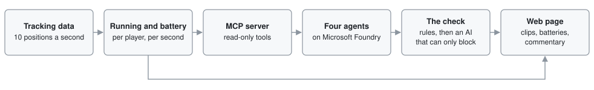
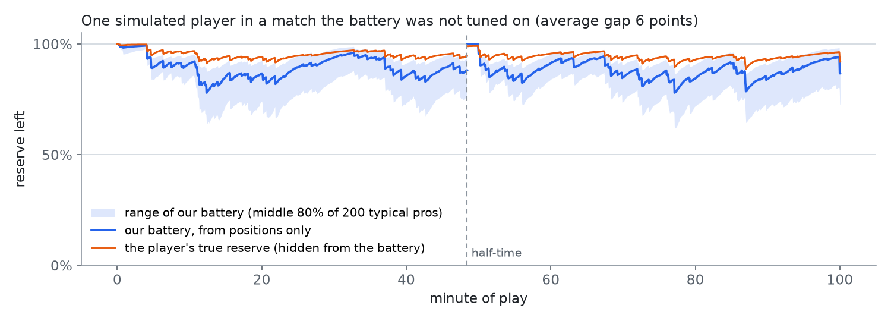

# Running Battery

How much hard running each football player has done, and how much short-term reserve a typical professional would have left after the same running.

Running Battery reads player tracking data (the position of every player and the ball, 10 times a
second) and measures each player's hard running, second by second. Each player's battery shows that
reserve as a percentage. Four AI agents on Microsoft Foundry turn those numbers into commentary for fans or analysts, and a check blocks any sentence the measurements or the
research don't support. It is our entry for the Microsoft x Premier League "Inside the Game"
hackathon.

The matches on the site are synthetic. We built a match simulator on published sports science, so
we know each player's true state and can test the battery against it.

**Live demo:** https://happy-bay-06ca1e90f.3.azurestaticapps.net/?match=story


## What you see

The page opens on the highlights of a simulated match: a card for each clip, then the clip on a
pitch with the player's battery, and beside it the numbers and the commentary. **Full match** is
the whole replay with every player's battery. Under the clip, "The whole match" sums up both
teams' running, with a map of every player's battery minute by minute. **How it works** explains the battery, the agents and the research behind them,
with charts that compare the published model with ours and show why critical speed can't be read
from a match, and references.

You can add these to the address: `?match=natural` for the second match, `&mode=analyst` for
analyst wording and the spread of the battery across the 200 typical professionals, `&view=full` or `&view=how` to open another view, and
`&theme=dark` or `&theme=light`.

## How it works



1. The simulator ([src/runningbattery/sim/](src/runningbattery/sim/)) generates a match at 10
   frames a second, with passes, shots and substitutions. Its players have a hidden physiology
   that changes which hard runs they make. Only the tests read it.
2. The estimator ([engine/](src/runningbattery/engine/)) works from positions alone. For each
   player and second it measures the running (distance above 5.5 m/s, his hardest minutes so far)
   and runs the battery for 200 typical professionals.
3. An MCP server ([agents/mcp_server.py](src/runningbattery/agents/mcp_server.py)) gives the agents
   seven read-only tools. Every number comes back with its unit and the measurement it came from.
4. Four agents (Microsoft Agent Framework, gpt-5-mini) write the commentary. The first picks the
   moments, the second writes each line from a list of 46 findings we took from sports research by
   hand, the third adapts it for fans or analysts, and the fourth is the check.
5. The check ([agents/verifier.py](src/runningbattery/agents/verifier.py)) runs fixed rules
   first: every number has to match a measurement, and every general statement about football has
   to agree with the findings list. A second AI then reads the sentence and can block it but can't
   rewrite it.
6. The page ([app/](app/)) is React and TypeScript, served as static files from Azure Static Web
   Apps.
7. A live runner ([live.py](src/runningbattery/live.py)) feeds the estimator one frame at a time,
   the way a stadium feed would, and never looks ahead.

## The battery

The battery is the D′ balance model from sports science [1, 2, 3], with distance in place of work.
Critical speed (CS) is the fastest pace a runner can keep up for a long time, and D′ is the distance
they can run above it before the reserve is gone. Each second, at speed v:

- above CS, the battery loses the metres run above it, v − CS;
- below CS, it refills towards D′ with a recharge time τ = k·D′ / (CS − v), between 30 s and 900 s;
- the more metres above CS so far in the match (W), the slower the refill:
  τ × (1 + α(1 − e^(−W / 400 m))), with α = 1 and half of W cleared at half-time.

A typical professional has a critical speed of 4.1 ± 0.3 m/s (14.8 km/h) [3, 4] and a D′ of
180 ± 54 m [5]. No study has measured D′ in professional players, so that value comes from
university players. Critical speed can't be read from tracking data: studies that fitted it to
players' running got about 2 m/s with one method and 3.6–4.0 m/s with another, and the first
study's authors say their value is likely well below the players' true critical speed [6, 7]. So we
take both values from fitness tests and never claim to know the player's own.

The standard model refills too fast for runners. We use k = 4, close to the recharge time measured
in runners [8]. Repeated hard efforts slow the refill further, as measured in cyclists [9], which
is what the wear term does; its two settings were fitted on 60 simulated matches and checked on 110
others.

We run the battery for 200 typical professionals drawn from those values and show the middle one;
analysts also see the range that holds the middle 80%. On screen it always reads as "running that
would leave a typical pro at X%", never as how tired the player is.

## What we added

The model and the typical professional's values come from the research above. We added four
things. The research applies the model to one athlete whose fitness has been tested; we apply it
to every player in a match, from their positions alone. Since we can't test the players, we run it
for 200 typical professionals and show the middle one. A typical professional whose battery the
player's running would push below empty counts for less, because the player is clearly fitter. We made the refill slow down as the match's hard running builds up, with a formula and
settings we fitted on simulated matches. And we test the battery on simulated matches where each
player's true state is known, which real matches can't offer.

The commentary is ours too: agents that only see measured numbers, and a check that blocks any
sentence the measurements or our list of research findings don't support.

## What we tested

### Does the battery match the truth?

Real matches can't tell us how much reserve a player really has left, so we tested the battery on
our simulated matches, where we know it for every player and every second. On matches we didn't use
to set the battery up, it was 6 points away from the true value on average, on a scale from 0 to
100%.

Because we don't know each player's fitness, the battery is worked out for 200 typical
professionals and the page shows the middle one. In analyst mode it also shows how spread out the
200 are: a range that holds the middle 80% of them. The true value fell inside that range 78% of
the time, close to the 80% it should.



The figure shows one player whose gap is close to that 6-point average. The battery follows when
his true reserve drops and recovers, but sits lower, because he is fitter than the middle typical
professional. The figure is made by
[scripts/battery_vs_truth.py](scripts/battery_vs_truth.py).

### Can positions tell who is tired?

No. We tried to find the moments when a player's true reserve was really low, using only where the
players were and how fast they moved. When the best method we could build flagged a moment, it was
right about 1 time in 5 (our battery: about 1 time in 7). The same running drains a fitter player
less, and positions don't show fitness. So the page never says a player is tired.

### Does the check stop wrong sentences?

Before a line of commentary reaches the page, a check reads it in two steps. First, fixed rules
compare every number with the measurements, and every general statement about football with our
list of research findings. Then a second AI reads the sentence; it can stop it but can't change it.

To test the check we wrote 192 sentences by hand: 119 that should be stopped (a wrong number, or a
claim the research doesn't support) and 73 correct ones. The fixed rules alone stopped 87 of the
119 and none of the correct ones. With the second AI added, the check stopped 116 of the 119, and
stopped 1 correct sentence by mistake.

### Do the simulated matches look like real football?

We generated 240 matches and compared them with numbers from published studies of the Premier
League and other leagues: how far each position runs, how much running drops in the last 15
minutes, how much of the match the ball is in play. Most fall inside the margin we set; the ones
that don't are listed in [docs/TECHNICAL.md](docs/TECHNICAL.md#validation).

We also compared how the simulated players move with 29 real matches that have tracking data (7
from the Bundesliga, 20 from Australia's A-League and 2 sample matches), and the passes, shots and
other events with 380 Premier League matches. The real data stayed on our computers; none of it is
in this repository or on the site.

### Does it work live?

We fed the story match to the battery one frame at a time, as a stadium feed would send it,
without looking ahead. The live battery was less than half a point away from the one on the site,
on average. Speeds arrive half a second late, because a live position can only be smoothed with
what has already happened, and one second of play takes 1.5 milliseconds to process. A player
reaches "his hardest minutes" when a stretch of one to five minutes is about as intense as his best
so far; of the 134 times that happened, the live version caught 128 within 30 seconds.

All the numbers, tables and figures are in [docs/TECHNICAL.md](docs/TECHNICAL.md).

## Limitations

- The matches are synthetic. A simulator built on published effects shows the estimator recovers
  those effects; it doesn't prove them in a given league.
- The battery describes a typical professional, not the player. Fitness can't be measured from
  tracking, and no professional D′ has been published.
- Positions can't tell who is tired, or whether a run was meant as pressing, so the commentary
  says neither.
- The simulated movement still differs from real football in places (runs are too short: 71% last
  1–2 s against 59–61% in real tracking), and some clips were hidden by hand because their movement
  didn't look like football.
- The live runner reads a match file frame by frame; it isn't connected to a tracking provider's
  feed, and the commentary is written per match, not per moment as it happens.
- The AI part of the check can give different answers on different runs. The fixed rules always
  give the same one.

## Run it

Python 3.12 with [uv](https://docs.astral.sh/uv/) and Node 20 or later. No Azure settings needed:

```bash
uv sync --all-extras && uv run pytest        # tests (one skips without the real tracking data)
(cd app && npm ci && npm run dev)            # the page at http://localhost:5173/?match=story

D=data/synthetic/demo/story
uv run python -m runningbattery.sim --seed 2028 --story press-fade --out $D   # a match
uv run python -m runningbattery.engine $D                                     # running and battery
uv run --extra agents python -m runningbattery.agents.feed $D --offline --out $D/feed.json
uv run python -m runningbattery.live $D --check                               # frame by frame
```

`--offline` writes the commentary from templates and runs only the fixed rules. The AI agents need
a Microsoft Foundry project: copy `.env.example` to `.env` and run `az login`. More commands are in
[docs/TECHNICAL.md](docs/TECHNICAL.md#development).

| Folder | What is in it |
|---|---|
| [src/runningbattery/sim/](src/runningbattery/sim/) | the match simulator |
| [src/runningbattery/engine/](src/runningbattery/engine/) | the running measures and the battery |
| [src/runningbattery/agents/](src/runningbattery/agents/) | MCP server, agents, findings list, check |
| [src/runningbattery/validate/](src/runningbattery/validate/) | the tests against the hidden truth and real matches |
| [app/](app/) | the web page and the two demo matches |
| [tests/](tests/) | unit and integration tests |
| [schemas/](schemas/) | JSON Schemas for tracking, events and signals |

## References

1. Skiba PF, Chidnok W, Vanhatalo A, Jones AM (2012). Modeling the expenditure and reconstitution of work capacity above critical power. *Medicine & Science in Sports & Exercise* 44, 1526–1532. https://doi.org/10.1249/MSS.0b013e3182517a80
2. Skiba PF, Clarke DC (2021). The W′ balance model: mathematical and methodological considerations. *International Journal of Sports Physiology and Performance* 16, 1561–1572. https://doi.org/10.1123/ijspp.2021-0205
3. Jones AM, Vanhatalo A (2017). The 'critical power' concept: applications to sports performance with a focus on intermittent high-intensity exercise. *Sports Medicine* 47, 65–78. https://doi.org/10.1007/s40279-017-0688-0
4. Modric T, Versic S, Sekulic D (2020). Aerobic fitness and game performance indicators in professional football players; playing position specifics and associations. *Heliyon* 6, e05427. https://doi.org/10.1016/j.heliyon.2020.e05427
5. Sutcliffe DP, Kramer M (2025). Exploring the utility of the 3-minute all-out running test in assessing match performance and external loads in university soccer players. *PLOS ONE* 20, e0323655. https://doi.org/10.1371/journal.pone.0323655
6. Mizelman E, Pearson A, Chu D, Clarke DC (2024). Critical speed models of high-resolution speed-duration profiles describe peak running demands in soccer. *International Journal of Sports Science & Coaching* 19, 2056–2066. https://doi.org/10.1177/17479541241246951
7. Lord C, Blazevich AJ, Abbiss CR, Drinkwater EJ, Ma'ayah F (2020). Comparing maximal mean and critical speed and metabolic powers in elite and sub-elite soccer. *International Journal of Sports Medicine* 41, 219–226. https://doi.org/10.1055/a-1065-2100
8. Bellenger CR, Nitschke M, Bartram JC (2025). Validation of end-of-session D′ balance for quantifying and differentiating exhaustive and nonexhaustive intermittent-training sessions in runners. *International Journal of Sports Physiology and Performance* 20, 718–726. https://doi.org/10.1123/ijspp.2024-0036
9. Chorley A, Bott RP, Marwood S, Lamb KL (2022). Bi-exponential modelling of W′ reconstitution kinetics in trained cyclists. *European Journal of Applied Physiology* 122, 677–689. https://doi.org/10.1007/s00421-021-04874-3

The papers behind the commentary's comparisons and the simulator are listed on the site's How it
works page and in [docs/TECHNICAL.md](docs/TECHNICAL.md); every paper we cite is in
[docs/References.bib](docs/References.bib).

## License

MIT. See [LICENSE](LICENSE).
