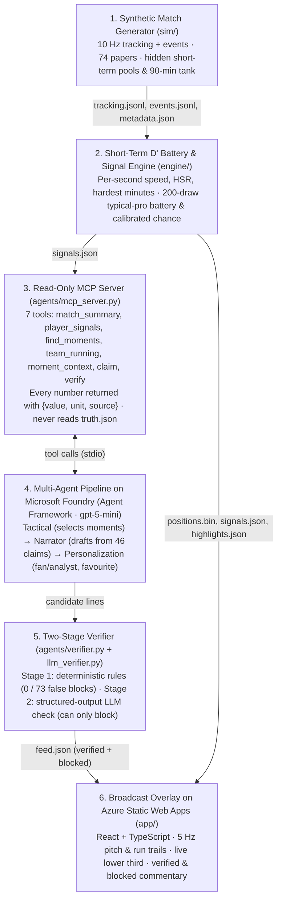

# Running Battery

> How much hard running each football player has done, and what it would leave a typical professional.

Running Battery measures from tracking data how much hard running each football player has done and what it would cost a typical professional, and explains it to fans and analysts through AI agents on Microsoft Foundry. It is an entry for the Microsoft x Premier League "Inside the Game" hackathon.

All match data is **synthetic**: we built a generator whose players get tired according to published sports science, with a hidden "true" fatigue we use to test our estimator.

**Try it:** https://happy-bay-06ca1e90f.3.azurestaticapps.net/?match=story (the story match, fan mode; the favourite is the left-back the story is about).
It opens on the **Highlights**: each clip plays once as it happened, then shows its details (numbers, sources and the Verifier's verdicts); "Replay" plays it again (a progress bar, Play/Pause and ½× 1× 2× work like a video player's), and "Full match" is the whole replay.
Add `?match=natural`, `&mode=analyst`, `&view=full&t=<seconds>`, `&hl=<kind>&step=details` (or `&step=replay` for the replay) or `&theme=dark` to the address.


- Project plan: [docs/PLAN.md](docs/PLAN.md)
- Build plan: [docs/BUILD_PLAN.md](docs/BUILD_PLAN.md)
- Evidence base (74 papers): [docs/RESEARCH_SYNTHESIS.md](docs/RESEARCH_SYNTHESIS.md); citation keys such as [Leifsson2024] are in [docs/References.bib](docs/References.bib)
- Data format: [src/runningbattery/schema.py](src/runningbattery/schema.py), JSON Schemas in [schemas/](schemas/)

## How it works



1. **Generator** (`sim/`): a 10 Hz match with events, a sprint motion model [Narizuka2023], role behaviours and a hidden physiology (two short-term pools and a whole-match tank) that changes which hard runs players make.
2. **Estimator** (`engine/`): from positions alone, per player and second, the running (high-speed distance, his hardest minutes so far, energy) and what it would leave a typical professional (a battery with a 10–90% band, and a calibrated chance of falling below half of it).
3. **Agents** (`agents/`): an MCP server with seven read-only tools, four agents on Foundry, and a Verifier that checks every sentence against a register of published claims.
4. **Overlay** (`app/`): the replay, the batteries, the charts and the verified feed, as static files on Azure.

## Agents

Four agents on Microsoft Foundry (Agent Framework, gpt-5-mini) turn a match into a timestamped,
verified feed (`feed.json`, synced to the replay or a video by `video_s`). They see the match
only through an MCP server with seven read-only tools, and every number comes back with its unit
and the field it came from; nothing in `agents/` can read the hidden truth. **Tactical** picks
the moments (a player's hardest minutes, a defender caught on the break, second wind, fresh legs, a quiet spell
that is likely tactical rather than fatigue, flat-out runs near a player's top speed, and who's doing
the running between the two teams, with where it happened); **Narrator** writes from the claims register's wordings;
**Personalization** sets the fan or analyst style and puts a favourite player (and whoever came
on for him) first; **Verifier** checks every sentence before it reaches the screen.

Plain code holds the agents to what the prompts ask: each moment offers only the claims that fit
it (the "after a player's hardest 5 minutes" figure only after a stretch that long, "top speed hardly drops"
only after the 75th minute), a team moment always says how the two teams compare, each general
finding is shown at most twice per feed, and "fewer touches" needs measured touch counts
(PLAN decision 25). A substitute's moment always compares him with his team-mates, and the
favourite's caught-on-the-break moment says what his running would leave a typical professional
(decision 31). A line tagged with a general finding whose numbers all come from the moment's
facts counts as a measured fact (decision 29). A team moment also says where the team's
high-speed running happened, as measured facts per minute of each situation (decision 30, below);
claim 4 ("losing the ball forces the hardest running of the game") may go with it, but not its
"tired legs", which on a team moment would be about the team (claim 35).

### The Verifier

It runs fixed rules first, then an LLM pass that can only block, against the claims register
(synthesis §5) and the moment's context: a sentence that blames fatigue while the team is 3–0
up, the ball is out of play or the player has just come on must say so, and every number must be
one of the facts. The paraphrases are blocked claims in other words, and the fact checks are
sentences that do or do not agree with their facts (F1); both were written before the rules or
the prompt that could catch them and never used to tune them. On 192 test sentences
([docs/verifier_report.json](docs/verifier_report.json), prompt revision 7, run on 2026-10-21 after
decision 37's rule changes ("typical pro" as a rule-24 baseline, G12: a published finding opened
with a player's name, rule 33 reading "his (estimated) typical-pro reserve", and G5 asking a team's
metres per minute to say they are high-speed running) and decision 38's rules, each from a line on the site's feed: G13, a scoreline is the score at
that moment (claim 13's example "a 3–0 lead" at 5–2); G5 for players too ("He averaged 23
m/min."); "level" only for no difference (two teams 5% apart); G14, the player a substitute
replaced is not compared "over the same minutes"; G9, the short-term reserve as a percentage rather
than a raw decimal; and claim 2 keeping "shaken off" or "recover"; and decision 39's G5 for a
percentage of plain "running" ("96% less running" that was his high-speed running)):

| | Unsupported sentences caught | Valid sentences blocked |
|---|---|---|
| Rules alone | 86 / 119 (paraphrases 2 / 23, fact checks 0 / 6) | 0 / 73 |
| Rules + LLM | 116 / 119 (paraphrases 23 / 23, fact checks 4 / 6) | 1 / 73 |

The LLM still misses sentences that mislead without a wrong number: claim 3 ("about a third fewer
recovery runs right after their hardest minutes") used as the lead-in to a defender's own speed
after a turnover, and two of the six held-out fact checks ("his fastest run so far" when it was
not, and "well below his match average" when it was not). The LLM pass varies: the ten runs on
2026-10-20–21, as the suite grew from 174 to 192
sentences, caught 106 / 108, 103 / 108, 106 / 109, 106 / 111, 110 / 112, 109 / 113, 113 / 115,
112 / 116, 114 / 118 and 116 / 119 and blocked 2 / 66, 1 / 66, 3 / 67, 4 / 68, 0 / 68, 3 / 69,
5 / 71, 4 / 72, 4 / 72 and 1 / 73
valid sentences (the 182-sentence run missed three of the six fact checks; the 188-sentence run missed one
paraphrase, "They swarmed the man on the ball to win it back high up the pitch"); the earlier runs also missed "the lowest
point of his match" when it was not, a team comparison with the wrong percentage ("roughly 22%
less") and a second fact check. With prompt revision 5 (166 sentences, 97/104) it also missed "the lowest point of his
match" when it was not and three of the six held-out fact checks, so the LLM pass is a second net,
not a guarantee. A general finding about short bursts used to explain a 76- or 197-second spell,
which it missed in every run, is now blocked by a rule (claim 2, below). In this run it blocked
four valid sentences: "He ran less after the break than before it" (claim 15), the typical-pro
chance worded with "in the red", "Fewer touches, partly because the ball was out of play more" and
"He did 64% more high-speed running per minute than his team-mates over the same minutes and 1% more than the player he replaced". Earlier runs
also blocked "Without the ball, Ravensholt are covering more ground per minute than with it", "His team kept the ball for most of the last five minutes, so he ran less; likely not
fatigue", "86% below his match average", a drop in running put down to a long stoppage and a
team's share of its high-speed running in the 10 s after the ball changed hands. The rules never block a valid sentence; the LLM pass varies by a sentence
or two from run to run (the first run of revision 6, on 173 sentences: 106/108, 1/65, with one
LLM check timed out).

The LLM prompt has been revised six times, each reported in PLAN §3.4: twice on the first
suite; once after the fourth demo feeds, where it blocked the neutral name of the post-peak window
as physiology seven times; once (decision 29) for the new names and a fact check it writes
before each verdict; once (decision 30) for "his hardest minutes"; and once (decision 31) to read
the moments' names ("second wind", "fresh legs", "caught on the break", "quiet spell") as
football's names for kinds of moment, after it once read "Second wind" as physiology. Rules added from reading
the feeds: no field names on screen ("G10"), "not only fatigue" as a statement about the
player's own state (claim 33), and baselines in words ("of the last five minutes"). With the
running split (decision 30): "pressing" and "closing down" are blocked (claim 39, below), on a
team moment any fatigue word is read as the team's own state (claim 35), and a share of the
running in a situation must give the share of the time too (G5). From reading those feeds:
"his typical-pro battery" (claim 33), "spell" for his hardest minutes, a reason pinned to the
typical-pro wording ("the two-goal lead may explain some of it"), percentages spelled out
("forty-three percent", which the numbers check cannot read) and claim 4 pinned on a player
("…one of those moments for Marco Tarvsall", while he ran at about 1 m/s). From the site's feed
(decision 31): "0% more" for two sides that were level (G10), a word both team names share
standing for one team ("Albion's", when both teams are "… Albion"; G11, a new global rule), and
claim 2 ("short bursts are shaken off in a minute or two") in a sentence that gives his own
stretch's length in seconds or minutes. Its held-out cases were written before the rule: the rules
caught 0 of 2 before it and 2 of 2 after, with both valid ones passing.

## The overlay

`app/` is a match broadcast, cleaned up (decision 36; the screens in [JOURNEY.md](JOURNEY.md),
the look in [DESIGN.md](DESIGN.md)). One column as wide as the pitch: the brand line ("Running
Battery · synthetic match" and what it shows), the score bug with each team's colour, the pitch,
one lower third docked under it, a quiet play bar, then four tabs: **Clips**, **Team sheet**,
**Details** and **Settings** (view, fan or analyst, match, favourite player, dark or light, the
key). While a clip plays, only the score, the pitch and the lower third ask for attention.

It opens on the **Highlights** (decision 29): one clip at a time, in match order, from the
match's best physical moments and the feed's moments. Each clip plays once, as it happened, at
normal speed, with only that player's path on the pitch (the others dimmed), in white, fading
towards its start with an arrowhead where he is. A moment measured over minutes shows the part
of the match it is about (decision 38): a counter-attack after his team lost the ball, or the run
behind a second wind or a substitute's fresh legs; a moment with nothing to see stays in the full
match's commentary, and one action is one clip. A clip stays inside its half, and a highlight
that spans a minute (back-to-back runs, the busiest minute) fast-forwards at 4× between the
player's high-speed runs, with "Fast-forward to his next run" on the play bar (decision 39).
Real tracking loses players for a moment (we
simulate it too, so the estimator copes with gaps); the pitch draws such a player faded, on the
line between where the tracking last and next saw him.
When it is over it stops on its last frame ("Clip ended · last frame") and the **Details** tab
opens (decision 34): the numbers (top speed, distance, metres above 5.5 m/s, the gap timer between
back-to-back runs), what the feed says about it, the run's speed second by second and his number
against the published one. Fans see one short label under each line ("Verified · measured",
"Verified · our estimate", "Verified · published research") that opens to the claim, the papers
and the check; analysts see the full citation and verdict, and the 10–90% band as the first line.
**Replay** plays the clip again at the clip speed (1× unless the viewer picks ½× or 2×), with the numbers growing; the progress bar seeks within the clip; **Next** starts the next
clip and gives back the tab the viewer was on. "Play highlights" leaves the details up for 6 s
before the next clip. The Clips tab shows each team's fastest second so
far.

**The battery is the one bold graphic** (decisions 32, 33, 36). The lower third names the clip or
moment and its player and shows his battery as the clip plays: what his running so far would leave
a typical professional, a squared shell with a near-white charge that never changes colour with its
level, the percentage beside it, and for analysts the 10–90% band as brackets. A team moment shows
each team's high-speed running per minute in play instead. The Team sheet tab lists both line-ups
with each player's battery, live; a click follows that player in the full match. Goalkeepers get
none. The empty shell is the logo.

**Full match** is the whole replay. In fan mode it shows a battery icon for the selected and
favourite players (a tick shows all of them); in analyst mode the selected player's battery trace
with its band and his high-speed running. To keep one obvious place to look, the player the
current feed line is about gets a ring and the lower third; the flat-out pulse
(90% or more of his top speed so far) and the hardest-minutes ring show only for him, the selected
and the favourite player, and the key is in Settings. Both teams' high-speed running per
ball-in-play minute is one chart, "High-speed running per minute". Under it, **high-speed running
by situation** (decision 30) splits each team's high-speed running by situation of play, from who
had the ball and where it was, as metres per minute of that situation (G5): the first 10 s after
losing the ball, the first 10 s after winning it (transitions last 9.3–10.9 s on average
[Bortnik2022, Table 2]), settled on the ball, and without the ball with it in the opponents'
third or deeper (the pitch in thirds, 17.5 m either side of halfway). Bars per team on one scale,
the minutes of each situation under its name, and per team the share of its high-speed running
that came in the 10 s after the ball changed hands; it sums the finished 15-minute blocks so far,
and a team moment's Replay shows its own block. In the story match's first half, 50% of Westerlyn Albion's
high-speed running came in those 10 s, in 33% of the time the ball was in play (324 m per minute after losing the ball against 98 settled on the ball). It says where the
running happened, never why: "pressing" is a purpose, and positions don't show it (below). Each
feed line shows its claim,
sources and the Verifier's verdict, and a toggle shows what the Verifier blocked. All of the
overlay's own text, labels and tooltips included (`app/src/copy.json`), passes the Verifier too.
Dark by default, light in Settings; phone layout with a 16 px gutter, plain dots on the pitch and
no sideways scroll.

**Highlights** are measured from positions and named as football names them: **top speed**
(against the average match top speed for his position [SilvaH2025, Table 1]), the **longest
run** above 5.5 m/s (19.8 km/h) in one go and where it went (a typical high-speed run is about
19 m [Fang2024, Table 2; DiSalvo2007, p.224]), the **recovery run** (the longest high-speed run
back towards his own goal starting within 10 s of his team losing the ball, our threshold; speed
and distance only; against the generator's hidden run purposes it is a recovery run 81% of the
time, base rate 28%, and finds 22% of them, dev seeds 1–60, decision 30), **back-to-back runs** (three or more with 20 s or less between them, our
threshold; Premier League players usually get 51–101 s between high-speed runs, by position
[Bradley2009, Table I]), the **busiest minute** (against a published average best minute of
62 m [Leifsson2024, Table 1]) and, at the final whistle, the **most ground covered** by
whole-match players (against the Premier League average for defenders, midfielders or forwards,
9.97 / 11.59 / 10.71 km [Kavanagh2024, Table 2]; Bradley2009, Table I agrees by position within
1–8%). The story match is short (92.8 min with added time, against a usual 99.5 [Allen2025,
Table 2]), and its most ground covered is 10.7 km. The panel shows the top 3 so far, one per
player; a click opens the clip, and "Play highlights" plays the clips one after another.
Captions come from fixed templates and pass the Verifier; they describe what the player did,
never how hard he tried (claim 38). Hardest accelerations and stops are left out: tracking
systems count them about 10-fold apart (claim 32).

The demo feeds are in [docs/feeds/](docs/feeds/): the story match (seed 2028, a high press that
fades, a full-back caught on the break again and again, a fresh substitute), the same match with that full-back
as the favourite (the one the site and the video use), and a natural match (seed 2031). Story
matches are never used for validation numbers.

## What we tested and don't claim

Each of these is a sentence fans would like to read. We tested it against the hidden truth of
synthetic matches, it does not hold up from positions, and the Verifier blocks it:

- **"He is tired."** With each player's true fitness, the generator's own physiology finds the
  tired moments almost perfectly (precision 0.996); without it, the best any positions-only
  detector reaches is precision 0.13 at recall 0.1, and our battery reaches 0.12 (dev seeds 1–60,
  [validate/ceiling.py](src/runningbattery/validate/ceiling.py)). The same running drains players of
  different fitness very differently. So we say what the running would cost a *typical*
  professional (claims 11 and 33).
- **"Which team is more tired."** Home-minus-away differences pick the team with more
  short-term tiredness 45–58% of the time (chance). They pick the team with more late-match wear
  60–67% of the time and plain high-speed running 58% (72% in the run before decision 40: with 60
  matches one match is 1.7 points, so the two do not differ clearly), and one match in three is
  still wrong (60 matches,
  [validate/teams.py](src/runningbattery/validate/teams.py)). We show the measured running
  instead: team totals per ball-in-play minute, and how a gap changed (claim 35).
- **"He ran slower than he could when it mattered."** After his team lost the ball, a slow defender had no
  run asked by his role in 95% of cases and skipped one in 4.2%; speed tells a skipped run from no
  run asked no better than chance (AUC 0.44). We give the speed, its share of his top speed and
  what happened (claim 38).
- **"He misplaced that pass because he was tired."** Pass completion is the same before and
  after a peak spell (80.3 vs 80.5% [Fang2024, Fig. 1]) and across the match [Carling2011,
  Table I], so the generator has no passing penalty and the Verifier blocks the claim (claim 20).
- **"Albion pressed high."** Pressing is what a run meant to do. A positions-only rule built on
  Ju2022's definition of closing down ("runs directly towards opposition player on or receiving
  the ball" [Ju2022, Table 1]: his team without the ball, the gap to the ball shrinking by 3 m or
  more and ending within 5 m) matches the generator's hidden close-down runs with precision 0.23
  (base rate 0.03) and recall 0.29; in the opponents' third, 0.37 and 0.04 (78,046 runs, dev seeds
  1–60, thresholds fixed before the first run, [validate/purposes.py](src/runningbattery/validate/purposes.py)).
  The split above shows where the running happened instead, and the Verifier blocks "pressing" and
  "closing down" (claim 39). A recovery-run rule does better (precision 0.72, recall 0.35 with
  Ju2022's "to be goal side when out of position"), but a recovery-run share would still come out
  about half the true one, so the split leaves it out.
- **"They won because they ran more."** Winners outrun losers only slightly (total distance
  +0.7% [Allen2026a, Table 3]) and total distance is unrelated to points [Allen2026b] (claim 30).

## Validation

**Estimator vs hidden truth.** The battery (blue, with its band) against the generator's hidden
pools (orange) for one player of a validation match; the calibration of the typical-pro chance
before and after its map (held-out matches: expected calibration error 0.008 → 0.0002); and how
well anything could tell *who* is tired from positions alone (above).


**No-fatigue control.** The same 240 synthetic matches with fatigue switched on and off. Most of
the published drop after a player's most intense spell appears even without fatigue (picking the
peak guarantees a lower value next, and play stops after peaks [Cortez2026, Table 3]); the
end-of-match decline is all fatigue.


**Realism.** 240 default synthetic matches (seeds 1–240) with fatigue on, and the same matches
with fatigue off in brackets, against published numbers. Our pass bands are proposals (synthesis
§6.1). Every row was re-run on the same 240 seeds on 2026-10-22, after decision 40: a clearance
goes behind for a corner only from the goal area (a keeper's clearance from 15 m out had gone over
his own line), players with a set-piece job walk or jog to their spots at the pace the restart
allows, below 5 m/s (they had jogged at up to 5.5 m/s whatever the wait), everyone stops sprinting
at the whistle, and a carry in the box heads for goal (the rows before are in the README at commit
1ca69da). High-speed running per position fell about 2 points, all of it while the ball was dead,
and is back within ±5% after a small retune of full-backs and central midfielders; full-backs'
sprint distance rose (+12.7% → +16.8%), team sprint distance a little (+6.9% → +7.3%), keepers'
high-speed running fell (28 → 27 m a match), and players walk a little more (time walking 0.4
points above decision 39, 1.4 above IDSSE).

| Check | Published (source) | Synthetic (no fatigue) | |
|---|---|---|---|
| Running > 4 m/s (14.4 km/h), last 15 min vs first 15 | −21% [Bradley2009, Fig. 2]; pass −10 to −30% | −21.5% (+1.5%) | pass |
| High-speed and sprint running, 2nd half vs 1st | about level [Bradley2009, p.162]; pass ±10% | −6.8 / −7.3% (+1.1 / +2.5%) | pass |
| Recovery time between hard efforts, last 15 min vs first 15 | +28% [Bradley2009, p.162–163]; pass +15 to +40% | +17.3% (−1.7%) | pass |
| 2nd half vs 1st, by first-half load (high / moderate / low) | −12 / 0 / 0% [Bradley2013, p.4] | −15 / −7 / 0% (−7 / +5 / +7%) | close |
| Substitutes vs whole-match players, same minutes | +15% [Bradley2013, Table IV] | +31% (+13%) | above |
| High-speed running after a 5-min peak, min 1–5, vs match average | −45 −29 −13 −8 −4% [Leifsson2024, Table 1] | −67 −33 −15 −9 +2% (−64 −32 −11 −1 0%) | minute 1 too deep, even without fatigue |
| 1-min high-speed peak | 62 m/min [Leifsson2024, Table 1] | 70 m/min (75) | about 13% above |
| Covering and recovery runs in the 5 min after a peak, vs match average | −22 to −44% and −34 to −43% [Ju2022, p.975] | −27 / −34% (−29 / −30%) | in range; without fatigue recovery runs just short of it |
| Hard runs after a peak: length, duration, speed | −23%, −32%, −3% [Fang2024, Table 2] | −17%, −16%, −2% (−17%, −15%, −2%) | shorter but not enough |
| Distance, high-speed and sprint per position | 2024/25 targets ±5% [Allen2024, Table 4; Allen2025] | all within ±5% except sprint distance FB +16.8, DM +7.6, CM +10.5%; team sprint +7.3% (keepers' high-speed running 27 m, −18%) | accepted gap (decision 11) |
| Shots per match; xG per shot | 24.4; 0.11 ± 0.15 [Bassek2025, p.6]; shots pass ±15% (PLAN §2.5) | 27.1; 0.16 (4.3 goals a match) | shots pass; xG per shot above: the simulated defence leaves about 12 clear chances a match, shot rather than passed back since decision 38 (0.14 and 3.4 goals before it) |
| Time in speed bands vs real tracking (IDSSE) | ±3 points [Bassek2025; Osgnach2010] | outfield within 1.5 points | pass |
| Ball in play | 50–63% [Kavanagh2024, p.80; Allen2026b, Table 2] | 58.2% | pass |
| Running by phase, per player slot | 133 / 145 / 63 m/min with the ball / without / stopped [Allen2026b, Table 5] | 126 / 138 / 57 (−5.7 / −4.7 / −9.6%) | pass (±10%) |
| Home and away teams move together | r = 0.68–0.75 [Allen2026a, Fig. 2]; pass 0.5–0.85 | high-speed 0.70, high-intensity 0.77, sprint 0.74; total distance 0.96 | total distance above (decision 11) |
| Energy per player and match | 61.1 ± 6.6 kJ/kg [Osgnach2010, p.174] | 58.4 ± 4.9 kJ/kg (dev seeds 1–60); real IDSSE 57.6 ± 4.5 | close |

**Same conclusions on real data.** We ran the estimator offline on the 7 real IDSSE matches
[Bassek2025] (calibration only; the data never enters the repo or the demo) and compared
conclusions, not accuracy (there is no fatigue truth there; PLAN §2.6). They agree on load,
distance per player, the battery's dips and the deep first minute after a peak. They disagree in
two places: real players faded more in the second half (high-speed running −21% vs our −6%), and
our synthetic peak spells are more intense (1-min peak 71 vs 65 m/min).

## Synthetic-data card

One paragraph per dimension of the checklist in [RuizPinto2026, Table 3].

**Objective.** The data exists to test an estimator of how much hard running players have done
and what it would cost a typical professional, against a fatigue state that real matches never
reveal. It is not meant to stand in for real matches in any other analysis.

**Structure.** Four files per match: 10 Hz tracking of 22 players and the ball (positions in
metres, ball in or out of play, possession), events (passes, carries, receptions, shots with xG,
duels, pressures, substitutions and more, each with a phase of play), metadata (line-ups,
positions, substitutions) and, for validation only, the hidden truth (two short-term pools and a
whole-match tank per player per second, the purpose of each run and the runs a tired player
skipped). Story matches deliberately hold more tired moments than natural ones, a class-imbalance
choice [RuizPinto2026]; they are only used for the demo, and precision and recall come from
natural matches.

**Generation.** A phase-of-play state machine, a sprint motion model [Narizuka2023] limited by
each player's acceleration–speed profile [Morin2021, Table 1], role behaviours (covering,
recovery runs, pressing), position noise of 0.05 m, and a hidden physiology from published
studies [Chorley2023; Bradley2009; Fang2024; Ju2022]. Players are drawn from a typical
professional population (critical speed 4.1 ± 0.3 m/s (14.8 km/h), D′ 180 ± 54 m; decision 13).
Effect sizes we could not find in the literature are labelled "our assumption" in
`sim/params.py`. Every match regenerates from its seed.

**Constraints.** Fatigue changes which hard runs players make and how long and fast they are; it
does not change passing accuracy, decisions or shooting, because the studies find no such effect
in matches [Fang2024; Carling2011]. Top speed and acceleration fall by at most 5% [Bradley2009,
p.163; SilvaJR2018, Table 5]. Players do not pace themselves, so the late-match fade is all
physiology; in real matches part of it is the player's choice [Snyder2023].

**Utility and fidelity.** The realism table above: the end-of-match decline, the halves,
substitutes, running by phase and real speed distributions are within their bands; the drop
after a peak spell is too deep (even without fatigue), peak spells are about 9–16% too intense,
and team sprint distance is 7% high. A no-fatigue control (the same seeds with fatigue off)
separates what is fatigue from what is selection. On real IDSSE matches the estimator reaches
the same conclusions except for the size of the second-half fade.

**Risk and deployment.** This shows that the estimator recovers fatigue under the published
effects we built in; it does not prove those effects in this league. A model tuned only on this
data would learn our assumptions. So the product claims only what survives that limit (the
running, and what it would cost a typical professional), the Verifier blocks the rest, and every
screen says the match is synthetic. No real player data is distributed: IDSSE (CC BY 4.0) was
used offline for calibration only.

## Limitations

- Our synthetic players don't pace themselves, so the generator's late-match fade is all
  physiology; in real matches part of it is the player's choice [Snyder2023; synthesis §8.1].
- The typical-pro chance is calibrated for a typical professional (dev seeds, professional
  prior). On matches with a wider range of players it stays poorly calibrated (expected
  calibration error 0.060 → 0.054), because a typical-pro signal cannot see who is less fit.
- On the 7 real IDSSE matches [Bassek2025] real players faded more in the second half than ours
  (high-speed running −21% vs −6%) and our synthetic peak spells are about 9% more intense
  (PLAN §2.6).
- The Verifier's LLM pass varies from run to run, and the feed's wording with it; the rules give
  the same verdict every time. The committed demo feeds are one run each.
- Player fitness (critical speed, D′) can't be measured from tracking; the professional prior is
  derived from published tests [Modric2020, Table 1; Jones2017], and no professional D′ has been
  published (synthesis §3.2.3).
- The overlay replays files; the live stream (Event Hubs) was cut (BUILD_PLAN §5).
- The same seed gives a slightly different match on another machine (floating point), so the
  overlay ships the exported demo data (`app/public/data/`) rather than regenerating it.

## Development

From a clean clone, without any Azure settings (checked on 2026-10-19 from a fresh clone, Python
3.12 with [uv](https://docs.astral.sh/uv/), Node 20+):

```bash
uv sync --all-extras && uv run pytest              # 1 test skips without the IDSSE data
uv run ruff check . && uv run ruff format --check .
(cd app && npm ci && npm run build)                # the overlay, into app/dist
D=data/synthetic/demo/story
uv run python -m runningbattery.sim --seed 2028 --story press-fade --out $D   # the story match
uv run python -m runningbattery.engine $D                                     # signals.json
uv run --extra agents python -m runningbattery.agents.feed $D --favourite H04 --offline --out $D/feed.json
uv run python -m runningbattery.export $D --out app/public/data/story --feed $D/feed.json
cd app && npm run dev                              # http://localhost:5173/?match=story
```

`--offline` uses the template Narrator and the rules-only Verifier. The LLM agents, the suite's
`--llm` pass, `scripts/foundry_smoke.py` and `scripts/deploy_site.sh` need a `.env` (copy
`.env.example`) and `az login`. The export overwrites the committed demo data in
`app/public/data/story` with this machine's match (`git checkout app/public/data` restores it).

```bash
uv sync --all-extras                 # Python 3.12 environment
uv run pytest                        # tests
uv run ruff check . && uv run ruff format --check .
uv run python -m runningbattery.schema   # re-export JSON Schemas after changing the models
uv run python -m runningbattery.sim --seed 1 --out data/synthetic/m0001   # generate one match
uv run python -m runningbattery.sim.summary data/synthetic/m0001          # summarise it
uv run python -m runningbattery.sim.replay data/synthetic/m0001 --start 12:00 --purposes  # replay.html
uv run python -m runningbattery.sim.batch --seeds 1-30 --json report.json # means over 30 matches
```

Calibration against IDSSE [Bassek2025] (offline only; the data never goes into the repo or the
demo): `uv sync --extra calib`, `uv run python scripts/fetch_idsse.py` (~2.4 GB), then
`uv run python -m runningbattery.sim.idsse` once (writes small derived files next to the raw data in
the git-ignored `data/raw/idsse/`), and add `--idsse` to `sim.batch` to compare speed and
acceleration bands. Replay as a GIF or still frames needs matplotlib (`--extra replay`), then add
`--gif` or `--stills 6`.

Estimator and validation:

```bash
uv run python -m runningbattery.engine data/synthetic/m0001                 # signals.json
uv run python -m runningbattery.validate.batch data/synthetic/validation    # estimator vs truth
uv run python -m runningbattery.validate.calibrate data/synthetic/dev       # refit the chance map (dev seeds only)
uv run python -m runningbattery.validate.real data/synthetic/dev --jobs 4   # IDSSE vs synthetic
uv run python -m runningbattery.validate.figures                            # docs/figures/*.png
```

Agents (`uv sync --extra agents`; Foundry settings in `.env`, keyless auth via `az login`):

```bash
uv run python scripts/foundry_smoke.py                                  # model access, quota, latency
uv run python -m runningbattery.agents.mcp_server data/synthetic/demo/story # MCP server (stdio)
uv run python -m runningbattery.agents.feed data/synthetic/demo/story --favourite H04  # feed.json (add --offline)
uv run python -m runningbattery.agents.highlights data/synthetic/demo/story # physical highlights
uv run python -m runningbattery.agents.verifier_suite --llm --json docs/verifier_report.json
scripts/demo.sh                                                         # both demo matches + feeds
uv run python scripts/clip_audit.py data/synthetic/demo/story app/public/data/story  # check every clip
```

Overlay (React + Vite, Node 20+) and deployment (Azure Static Web Apps, Free plan):

```bash
cd app && npm ci && npm run dev       # http://localhost:5173/?match=story&mode=analyst&player=H04&t=3500
scripts/deploy_site.sh                 # build app/ and deploy the committed data
```

## License

MIT. See [LICENSE](LICENSE).
