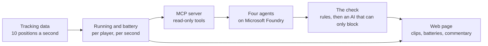

# Running Battery

How much hard running each football player has done, and what that running would leave a typical professional.

**Live demo:** https://happy-bay-06ca1e90f.3.azurestaticapps.net/?match=story


Running Battery reads player tracking data (the position of every player and the ball, 10 times a
second) and measures each player's hard running, second by second. A battery shows what the same
running would leave a typical professional. Four AI agents on Microsoft Foundry turn those numbers
into commentary for fans or analysts, and a check blocks any sentence the measurements or the
research don't support. It is our entry for the Microsoft x Premier League "Inside the Game"
hackathon.

The matches on the site are synthetic. We built a match simulator on published sports science, so
we know each player's true state and can test the battery against it.

## What you see

The page opens on the highlights of a simulated match: a card for each clip, then the clip on a
pitch with the player's battery, and beside it the numbers and the commentary. **Full match** is
the whole replay with every player's battery. **How it works** explains the battery, the agents and
the research behind them, with references.

You can add these to the address: `?match=natural` for the second match, `&mode=analyst` for
analyst wording and the battery's range, `&view=full` or `&view=how` to open another view, and
`&theme=dark` or `&theme=light`.

## How it works



1. The simulator ([src/runningbattery/sim/](src/runningbattery/sim/)) generates a match at 10
   frames a second, with passes, shots and substitutions. Its players have a hidden physiology
   that changes which hard runs they make. Only the tests read it.
2. The estimator ([engine/](src/runningbattery/engine/)) works from positions alone. For each
   player and second it measures the running (distance above 5.5 m/s, his hardest minutes so far)
   and runs the battery for 200 typical professionals.
3. An MCP server ([agents/mcp_server.py](src/runningbattery/agents/mcp_server.py)) gives the agents
   seven read-only tools. Every number comes back with its unit and the measurement it came from.
4. Four agents (Microsoft Agent Framework, gpt-5-mini) write the commentary. The first picks the
   moments, the second writes each line from a list of 46 findings we took from sports research by
   hand, the third adapts it for fans or analysts, and the fourth is the check.
5. The check ([agents/verifier.py](src/runningbattery/agents/verifier.py)) runs fixed rules
   first: every number has to match a measurement, and every general statement about football has
   to agree with the findings list. A second AI then reads the sentence and can block it but can't
   rewrite it.
6. The page ([app/](app/)) is React and TypeScript, served as static files from Azure Static Web
   Apps.
7. A live runner ([live.py](src/runningbattery/live.py)) feeds the estimator one frame at a time,
   the way a stadium feed would, and never looks ahead.

## The battery

The battery is the D′ balance model from sports science [1, 2, 3], with distance in place of work.
Critical speed (CS) is the fastest pace a runner can keep up for a long time, and D′ is the distance
they can run above it before the reserve is gone. Each second, at speed v:

- above CS, the battery loses the metres run above it, v − CS;
- below CS, it refills towards D′ with a recharge time τ = k·D′ / (CS − v), between 30 s and 900 s;
- the more metres above CS so far in the match (W), the slower the refill:
  τ × (1 + α(1 − e^(−W / 400 m))), with α = 1 and half of W cleared at half-time.

A typical professional has a critical speed of 4.1 ± 0.3 m/s (14.8 km/h) [3, 4] and a D′ of
180 ± 54 m [5]. No study has measured D′ in professional players, so that value comes from
university players. Critical speed can't be read from tracking data: studies that fitted it to
players' running got about 2 m/s with one method and 3.6–4.0 m/s with another, and the first
study's authors say their value is likely well below the players' true critical speed [6, 7]. So we
take both values from fitness tests and never claim to know the player's own.

The standard model refills too fast for runners. We use k = 4, close to the recharge time measured
in runners [8]. Repeated hard efforts slow the refill further, as measured in cyclists [9], which
is what the wear term does; its two settings were fitted on 60 simulated matches and checked on 110
others.

We run the battery for 200 typical professionals drawn from those values and show the middle one;
analysts also see the range that holds the middle 80%. On screen it always reads as "running that
would leave a typical pro at X%", never as how tired the player is.

## What we tested

- On held-out simulated matches the battery is off by 0.06 of the reserve on average compared with
  the hidden truth, and its 10–90% range holds the true value 78% of the time. On matches with a
  wider spread of players: 0.09 and 60%.
- Positions can't tell who is tired. Even the best positions-only detector we could build finds a player's truly low moments with a precision of 0.20 (ours: 0.15). The same running
  drains players of different fitness very differently, so the page never says a player is tired.
- We tested the check on 192 sentences we wrote, including paraphrases written before the rules
  that could catch them:

  | | Unsupported sentences blocked | Correct sentences blocked |
  |---|---|---|
  | Fixed rules | 87 of 119 | 0 of 73 |
  | Fixed rules + AI | 116 of 119 | 1 of 73 |

- We compared 240 simulated matches with published numbers from the Premier League and other
  leagues (running per position, the drop late in matches, the drop after a player's hardest
  minutes, ball in play, energy). Most pass; the ones that don't are listed. The movement was also
  compared with 29 real tracked matches (Bundesliga, A-League and two sample matches) and the events
  with 380 Premier League matches. Real data was used on our machine only; none is in this
  repository or on the site.
- On the story match the live runner's battery stays within half a point of the replay
  on average, speeds arrive 0.5 s later, a second of play takes 1.5 ms to process, and 128 of the
  134 times a player reached his hardest minutes are caught within 30 s.

All tables, figures and the full list of gaps are in [docs/TECHNICAL.md](docs/TECHNICAL.md).

## Limitations

- The matches are synthetic. A simulator built on published effects shows the estimator recovers
  those effects; it doesn't prove them in a given league.
- The battery describes a typical professional, not the player. Fitness can't be measured from
  tracking, and no professional D′ has been published.
- Positions can't tell who is tired, or whether a run was meant as pressing, so the commentary
  says neither.
- The simulated movement still differs from real football in places (runs are too short: 71% last
  1–2 s against 59–61% in real tracking), and some clips were hidden by hand because their movement
  didn't look like football.
- The live runner reads a match file frame by frame; it isn't connected to a tracking provider's
  feed, and the commentary is written per match, not per moment as it happens.
- The AI part of the check can give different answers on different runs. The fixed rules always
  give the same one.

## Run it

Python 3.12 with [uv](https://docs.astral.sh/uv/) and Node 20 or later. No Azure settings needed:

```bash
uv sync --all-extras && uv run pytest        # tests (one skips without the real tracking data)
(cd app && npm ci && npm run dev)            # the page at http://localhost:5173/?match=story

D=data/synthetic/demo/story
uv run python -m runningbattery.sim --seed 2028 --story press-fade --out $D   # a match
uv run python -m runningbattery.engine $D                                     # running and battery
uv run --extra agents python -m runningbattery.agents.feed $D --offline --out $D/feed.json
uv run python -m runningbattery.live $D --check                               # frame by frame
```

`--offline` writes the commentary from templates and runs only the fixed rules. The AI agents need
a Microsoft Foundry project: copy `.env.example` to `.env` and run `az login`. More commands are in
[docs/TECHNICAL.md](docs/TECHNICAL.md#development).

| Folder | What is in it |
|---|---|
| [src/runningbattery/sim/](src/runningbattery/sim/) | the match simulator |
| [src/runningbattery/engine/](src/runningbattery/engine/) | the running measures and the battery |
| [src/runningbattery/agents/](src/runningbattery/agents/) | MCP server, agents, findings list, check |
| [src/runningbattery/validate/](src/runningbattery/validate/) | the tests against the hidden truth and real matches |
| [app/](app/) | the web page and the two demo matches |
| [tests/](tests/) | unit and integration tests |
| [schemas/](schemas/) | JSON Schemas for tracking, events and signals |

## References

1. Skiba PF, Chidnok W, Vanhatalo A, Jones AM (2012). Modeling the expenditure and reconstitution of work capacity above critical power. *Medicine & Science in Sports & Exercise* 44, 1526–1532. https://doi.org/10.1249/MSS.0b013e3182517a80
2. Skiba PF, Clarke DC (2021). The W′ balance model: mathematical and methodological considerations. *International Journal of Sports Physiology and Performance* 16, 1561–1572. https://doi.org/10.1123/ijspp.2021-0205
3. Jones AM, Vanhatalo A (2017). The 'critical power' concept: applications to sports performance with a focus on intermittent high-intensity exercise. *Sports Medicine* 47, 65–78. https://doi.org/10.1007/s40279-017-0688-0
4. Modric T, Versic S, Sekulic D (2020). Aerobic fitness and game performance indicators in professional football players; playing position specifics and associations. *Heliyon* 6, e05427. https://doi.org/10.1016/j.heliyon.2020.e05427
5. Sutcliffe DP, Kramer M (2025). Exploring the utility of the 3-minute all-out running test in assessing match performance and external loads in university soccer players. *PLOS ONE* 20, e0323655. https://doi.org/10.1371/journal.pone.0323655
6. Mizelman E, Pearson A, Chu D, Clarke DC (2024). Critical speed models of high-resolution speed-duration profiles describe peak running demands in soccer. *International Journal of Sports Science & Coaching* 19, 2056–2066. https://doi.org/10.1177/17479541241246951
7. Lord C, Blazevich AJ, Abbiss CR, Drinkwater EJ, Ma'ayah F (2020). Comparing maximal mean and critical speed and metabolic powers in elite and sub-elite soccer. *International Journal of Sports Medicine* 41, 219–226. https://doi.org/10.1055/a-1065-2100
8. Bellenger CR, Nitschke M, Bartram JC (2025). Validation of end-of-session D′ balance for quantifying and differentiating exhaustive and nonexhaustive intermittent-training sessions in runners. *International Journal of Sports Physiology and Performance* 20, 718–726. https://doi.org/10.1123/ijspp.2024-0036
9. Chorley A, Bott RP, Marwood S, Lamb KL (2022). Bi-exponential modelling of W′ reconstitution kinetics in trained cyclists. *European Journal of Applied Physiology* 122, 677–689. https://doi.org/10.1007/s00421-021-04874-3

The papers behind the commentary's comparisons and the simulator are listed on the site's How it
works page and in [docs/TECHNICAL.md](docs/TECHNICAL.md); every paper we cite is in
[docs/References.bib](docs/References.bib).

## License

MIT. See [LICENSE](LICENSE).
